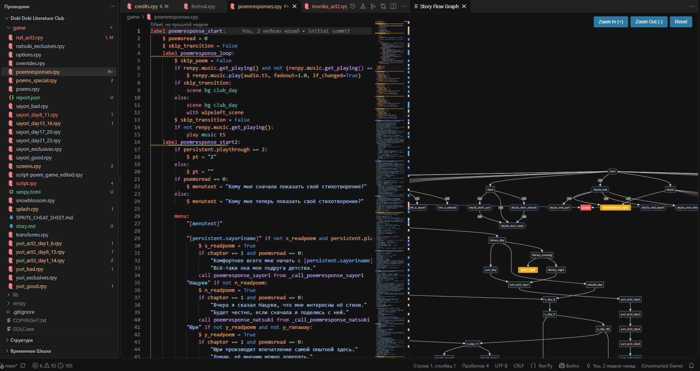
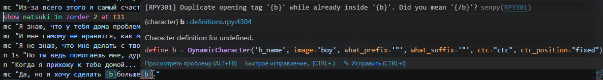
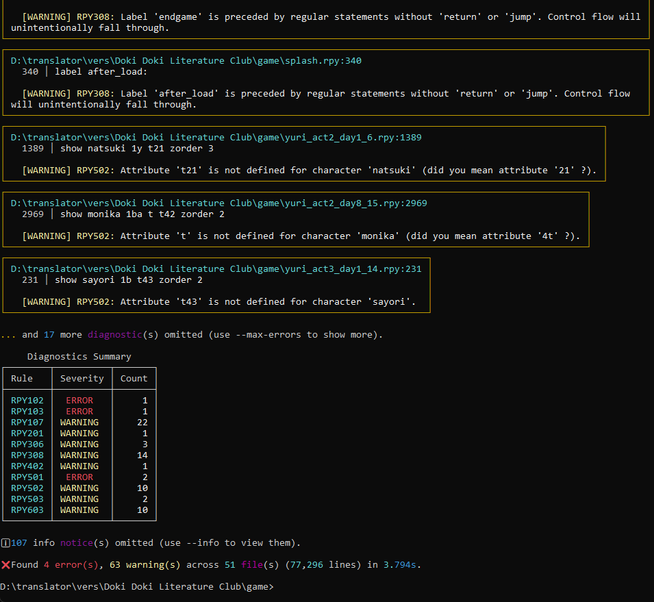
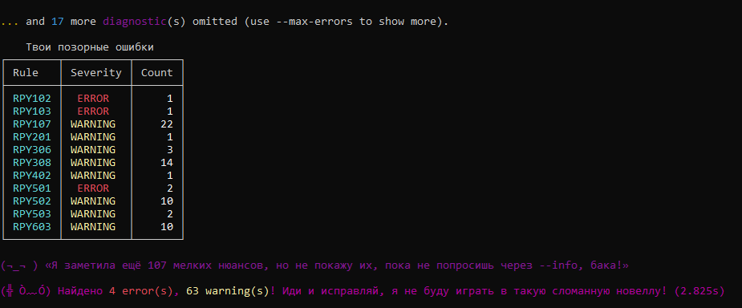
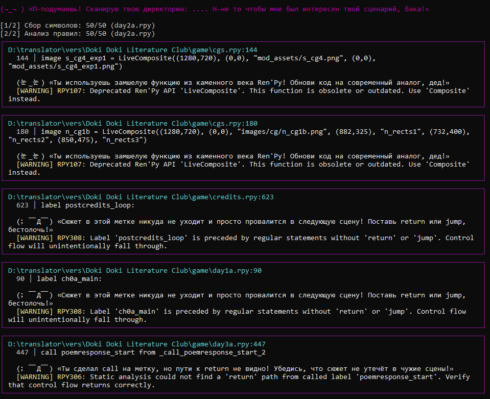

<p align="center">
  <a href="README.md"><b>English</b></a> | <a href="README_ru.md"><b>Русский</b></a>
</p>

# Senpy (`senpy-linter`)

<p align="center">
  <a href="https://www.python.org/downloads/"></a>
  <a href="https://www.renpy.org/"></a>
  <a href="LICENSE"></a>
  <br>
  
  
  <a href="https://github.com/Xilleet/senpy/actions"></a>
  <a href="RULES.md"></a>
  <a href="ARCHITECTURE.md"></a>
  <a href="https://github.com/Xilleet/senpy/actions"></a>
  <a href="https://github.com/Xilleet/senpy/actions"></a>
  <a href="docs/corpus-workflow.md"></a>
  <a href="https://github.com/Xilleet/senpy/actions/workflows/ci.yml"></a>
</p>

<p align="center">
  <b>"Notice me, Senpy! (⁄ ⁄>⁄ ▽ ⁄<⁄ ⁄)"</b><br>
  <i>Senpy — Fast static analyzer, semantic linter, control-flow analyzer and VS Code language server for Ren'Py visual novels. Detects undefined variables, broken labels, control-flow bugs, rollback/save issues, translation errors, and more.</i>
</p>



---

## Quick Install

**CLI / CI / Linux / macOS:**
```bash
pip install senpy-linter
```

**VS Code Extension (Windows, zero Python setup):**
Download the latest `senpy-vscode-X.X.X.vsix` from the [Releases](https://github.com/Xilleet/senpy/releases) page → Install from VSIX in VS Code.

---

## Status: Feature Freeze → 1.0

Senpy 0.9.3 is production-stable for users. Until 1.0, I'm focusing on
architecture hardening and `senpy.api` contract stabilization —
**no new rules, no new features, no new output formats**.

Why: the core has accumulated architectural debt that the changelog
hints at ("three sources of truth for terminators", "`--strict`
documented but absent from `args.py`", "`setup_logging()` never
called"). Symptoms visible in code: facade wrappers in `analyzer.py`
that erase type signatures, LSP server state held in module-level
globals (97 cyclic-import workarounds via `TYPE_CHECKING` / lazy
import), oversized modules (`python_ast.py` 1772 lines,
`lsp/handlers/navigation.py` split into 6 sub-modules in 0.6.0), tests
coupled to internals (485 imports from `senpy.core/rules/cli/lsp` vs
18 from the public `senpy.api`). I want to close this systematically
before declaring 1.0 API stability.

**What's accepted during the freeze:** bug fixes, false-positive
reports, security advisories, documentation improvements.

**What's deferred to post-1.0:** new rules (RPY0xx–RPY8xx expansion,
RPY9xx plugin ecosystem), new output formats, new CLI generators,
formatter extensions, sandbox R&D, editor clients beyond VS Code.

---
## What's New

### 0.9.3 — Corpus infrastructure finalisation + post-0.9.2 changelog catch-up (patch)

A patch release closing the **corpus FP-pipeline** as a stable, contributor-ready surface — and catching up on FIX tasks that landed in master after `v0.9.2` (and a few that were already in `v0.9.2` but absent from its changelog).

**2329 tests** (up from 2234 in 0.9.2, +95). **No new rules.** Feature freeze unchanged. The corpus GREEN-fix work (CORPUS-6: rule edits under 30–60 FP cases from triage) is deferred to **1.1.0** — mass rule-editing violates the freeze.

| Area | What Was Broken | What Changed |
|---|---|---|
| **Corpus FP-pipeline infrastructure** | No way to catch false positives on real-world VN code. The 5-VN corpus from 0.8.2 (DDLC, LearnToCodeRPG, cross_channel, DDLCModTemplate, renpy-template) was too small to surface rule regressions. | Three new scripts (`collect_corpus.py`, `run_corpus.py`, `triage_corpus.py`) clone 15 OSS VN projects (~3 GB, gitignored), run senpy per-project, and triage diagnostics into TP/FP/maybe-FP. `tests/rules/test_corpus_fp.py` auto-discovers labelled FPs from `tests/_corpus_triage.json` and turns each into a parametrised RED pytest. `tests/_corpus_manifest.json` pins each VN to a specific commit SHA with SPDX license metadata. Comprehensive `docs/corpus-workflow.md` + `CONTRIBUTING.md` section make the pipeline contributor-ready. |
| **Weekly regression CI workflow** | Corpus infrastructure existed but nothing ran it on a schedule — drift between rule changes and the corpus baseline went undetected. | New `.github/workflows/corpus-regression.yml`: weekly cron (Mon 06:00 UTC) + `workflow_dispatch`. Clones the corpus, runs `run_corpus.py` (drift check vs `tests/_corpus_baseline.json` — reported, not gated), runs `tests/rules/test_corpus_fp.py` (RED state expected pre-1.0 — reported, not gated), uploads summary artifact + JUnit XML with 28-day retention. |
| **Corpus-count badge** | No public signal that the corpus existed or was active — contributors had no way to know the pipeline was alive. | New `_build_corpus_badge()` in `scripts/update_badges.py` reads `tests/_corpus_manifest.json` + `tests/_corpus_triage.json`, writes `.github/badges/corpus.json` (pushed to the existing GitHub Gist by `push_badges_to_gist.py`). Color signals pipeline health: `red` = no corpus, `yellow` = unstaffed (projects but zero FPs labelled), `brightgreen` = at least one FP labelled. Badge added to `README.md` + `README_ru.md`. |
| **`docs.yml` single-job build + deploy** | Original 2-job design (build → upload-artifact → download-artifact → upload-pages-artifact → deploy) failed intermittently with "No artifacts named 'github-pages'" — `actions/download-artifact@v8` is not a stable release on github.com (latest stable is v4 as of Oct 2026). | Collapsed into one job: `mkdocs build --strict` writes `site/` on the same runner that then calls `configure-pages` → `upload-pages-artifact` → `deploy-pages`. If `mkdocs build --strict` fails, deploy steps do not run — no partial site is ever published. |
| **`docs.yml` pinned to official stable pair + orphan-artifact cleanup** | `upload-pages-artifact@v5` + `deploy-pages@v5` exhibited "Multiple artifacts named 'github-pages' were unexpectedly found. Artifact count is 2" (actions/deploy-pages#338, #451) — cancelled sibling runs left orphaned `github-pages` artifacts in storage. | Rolled back to `upload-pages-artifact@v3` + `deploy-pages@v4` (GitHub blog Dec 5 2024: "must be updated to use actions/upload-pages-artifact@v3 actions/deploy-pages@v4"). Added `actions/github-script@v7` cleanup step before upload: enumerates all `github-pages` artifacts in the repo via `github.rest.actions.listArtifactsForRepo` and deletes any not belonging to the current `context.runId`. |
| **`mkdocs build --strict` link fixes** | Three pages existed in `docs/` but were not in `nav`: `FORMAT_STYLE_GUIDE.md`, `corpus-workflow.md`, `renpy_api_diff.md`. `corpus-workflow.md` linked to repo-root files via `../` (mkdocs only sees `docs/`). Anchor `#current-capabilities--limitations` did not match the Material slugifier output. | 4 unique links rewritten to `https://github.com/Xilleet/senpy/blob/main/<file>` (same pattern as `docs/index.md`). Anchor fixed: `#current-capabilities--limitations` → `#current-capabilities-limitations`. 3 entries added to `Reference` nav. `site/` added to `.gitignore`. |
| **`clean_internal_ids` whitelist sync** | `docs/corpus-workflow.md` was in `_WHITELIST_PATHS` of `scripts/clean_internal_ids.py` but NOT in the mirror list in `tests/core/test_clean_internal_ids.py` — drift caught by `test_whitelist_in_sync_with_script`. | Added `"docs/corpus-workflow.md"` to the test's whitelist (single-line addition). |
| **Post-0.9.2 FIX-* catch-up in changelog** | (formatter: `_find_comment_start`, unary right-boundary, `#`-comment split in `_split_by_strings`) and the PyInstaller-spec fix (`senpy.spec` `collect_all` + `importlib.resources` loader) landed in `v0.9.2` code but were absent from the 0.9.2 release notes. | Closed catch-up section in CHANGELOG 0.9.3 with the missing entries + commit SHAs for git-blame traceability. |

Full details in [`CHANGELOG.md`](CHANGELOG.md#093).

---

### 0.9.2 — Ren'Py 8.6.1 compatibility + 25 critical bugfixes (patch)

A patch release combining **Ren'Py 8.6.1 compatibility** (data refresh + auto-extracted `BUILTIN_SYMBOLS` + extended `DEPRECATED_APIS`) with **25 bugfixes** backported from the 0.9.5 roadmap. After landing the 8.6.1 data refresh, it became clear that a "compat-only" patch would not give users a reason to upgrade — so 5 clusters of high-impact, low-architectural-risk fixes were pulled forward into 0.9.2.

| Area | What Was Broken | What Changed |
|---|---|---|
| **Ren'Py 8.6.1 data refresh** | API data was pinned to 8.5.3; new `config.add_to_special_directories` entry (multiple search directories in 8.6) was missing. | `renpy_api_source.yaml` now references `8.6.1.26111705`. `renpy_api_generated.json` regenerated (755 entries, +1). New `scripts/diff_renpy_api.py` script generates `docs/renpy_api_diff.md` with added/removed/changed entries between any two JSON snapshots. |
| **`BUILTIN_SYMBOLS` auto-extracted from JSON** | Every time Ren'Py added a new runtime namespace, Senpy's RPY202 fired on it before the maintainer noticed. `preferences` namespace (37 entries in 8.6.1) was missing entirely. | `senpy/core/renpy_builtins.py` now derives top-level namespace roots (`config`, `gui`, `build`, `renpy`, `persistent`, `preferences`, `layeredimage`) from the generated JSON at module load. New namespaces appear automatically on the next pin bump — no manual edit needed. |
| **`DEPRECATED_APIS` extended with `im.*`** | All 18 `im.*` image manipulator functions/methods (deprecated since Ren'Py 7.4.0) were not flagged by RPY107. Users had no warning before upgrading. | 8 `im.*` functions + 10 `im.matrix.*` methods + `config.images_directory` (superseded in 8.5.0) now flagged by RPY107 with concrete Transform-property replacement advice. Total: 15 → 34 deprecated entries. |
| **FIPS-safe MD5 in GitLab renderer** | `hashlib.md5()` without `usedforsecurity=False` raised `ValueError` on FIPS-enabled systems (RHEL/Fedora, corporate images), crashing the entire GitLab Code Quality renderer. | `hashlib.md5(..., usedforsecurity=False)` — one keyword argument, available since Python 3.9+. |
| **Trust store cross-process lock** | Concurrent LSP + CLI (or two parallel CLI invocations) could lose grants: P1 reads {A}, P2 reads {A}, P1 writes {A,B}, P2 writes {A,C} → B silently lost. | `senpy/plugins/security.py` now guards the read-modify-write cycle with a cross-process file lock (`fcntl.flock` POSIX / `msvcrt.locking` Windows), same pattern as `CacheManager` in `senpy/core/cache.py`. |
| **Plugin audit catches `importlib.import_module`** | `importlib.import_module("os").system("...")` bypassed the audit — the modern replacement for `__import__()` was not flagged. | `importlib` added to `_DANGEROUS_IMPORTS`, `import_module` added to `_DANGEROUS_MODULE_ATTRS`. Same security risk, same warning. |
| **`bool` arithmetic now numeric** | `True + 1`, `True * 3`, `bool += int`, `True - False` triggered RPY108. `bool` is a subtype of `int` in Python (True == 1, False == 0). | `bool` added to the numeric type set in `_infer_binop` / `_check_binop_incompatible`. Result of bool+numeric is `int` (matching Python: `True + True == 2`, not `True`). |
| **`dict.keys()`/`values()`/`items()` not `list`** | `$ ks = d.keys(); $ ks.append(x)` was considered valid — but `dict_keys` has no `append()`, crashes at runtime. | Returns `None` (unknown type) so RPY108 treats it conservatively. |
| **LSP word extractor Unicode-aware everywhere** | F12 worked on non-ASCII labels (`золото`, `はじめ`) but Shift+F12 / F2 / call hierarchy / document highlight / workspace symbol silently did nothing — 5 inline ASCII-only regex copies. | All 5 inline copies now delegate to the canonical `_word_at_position` in `_shared.py`. Off-by-one on word boundary also fixed. |
| **`progress_print` guards stdout in LSP mode** | An accidental `progress_print` call from LSP context corrupted the JSON-RPC transport and the editor dropped the connection. | `progress_print` no-ops when `SENPY_LSP=1` (set by `start_lsp()`) or when stdout is not a TTY. |
| **`init_ci_workflow` no longer silently overwrites** | `senpy --init-ci` on a project with an existing `.github/workflows/senpy.yml` clobbered manual edits (extra steps, matrix, env vars). | New `--force` CLI flag required to overwrite. Without it, the file is left untouched and a WARNING is printed. `was_created` return value honestly reflects whether the file was written. |
| **`init_ci_workflow` pins Senpy version + adds gate step** | `pip install --upgrade senpy-linter` in the generated workflow meant every CI run picked up the latest Senpy (~2 releases/day), churning SARIF outputs and rule sets. Also no CI gate — `continue-on-error: true` on the scan step meant CI never failed on ERROR-severity diagnostics. | Generated workflow now uses `pip install senpy-linter==<version>` (pinned). New `--errors-only` gate step (without `continue-on-error`) fails CI on ERROR-severity diagnostics — SARIF step keeps `continue-on-error` so the report is still uploaded. |
| **`init_ci_workflow` derives `scan_target` from `target_path`** | `senpy --init-ci path/to/my/game` in a monorepo generated a workflow scanning `.` (the entire repo). Paths with spaces (`My Games/foo`) broke the shell command. | `scan_target` is now the repo-relative form of `target_path`. `shlex.quote()` neutralises spaces. |
| **`__version__.py` MAJOR/MINOR/PATCH derived** | Three independent hardcoded ints — anyone who bumped only `__version__` left them on old values, and `CacheManager.compute_environment_fingerprint` (which hashes `MAJOR.MINOR`) produced wrong hashes. | `MAJOR, MINOR, PATCH = (int(x) for x in __version__.split("."))` — derived, always in sync. |
| **LSP generation-counter thread-safe** | `full_generation += 1` is not atomic in Python — two concurrent `schedule_full_diagnostics` (e.g. `did_save` + `did_open` overlapping) could both load 5, both store 6, both proceed with `new_gen=6`, defeating the stale-worker guard. | Both generation counters (`full_generation` and per-URI `change_generations`) now guarded by `_lsp_server._generation_lock`. `new_gen` is captured inside the lock so two concurrent callers never get the same value. |
| **`SymbolTable.rebuild_from_scopes` clears 3 more registries** | `transforms`, `screen_action_jumps`, `used_screens` were not cleared before the update loop — a plugin or LSP fast-path extension calling `rebuild_from_scopes` without a prior `reset()` accumulated stale entries. | All three registries now cleared before the update loop. |
| **HTML report + LSP null-guard `line_content`** | `diag.line_content.strip()` on `None` (project-level diagnostics, or rules that forgot the field) crashed HTML report / LSP `publishDiagnostics` for the affected file. | `(diag.line_content or "").strip()` in `html_report.py`, `raw_text = diag.line_content or ""` in `lsp/server.py`. |
| **Mermaid sanitizer extended** | `_add_screen_use_edges` was the only edge builder missing `_mermaid_safe_id()` — a screen named `preferences.audio` or `end` broke the diagram. | Both `src` and `tgt` now sanitized. `_MERMAID_RESERVED_IDS` extended from `{"end"}` to 9 keywords. |
| **`screen.py` masks string literals before `action` regex** | `textbutton "Read the action Function(x) docs":` produced false-negative RPY203 (word "action" in dialogue text) and false-positive RPY206 (`Function(` from dialogue). | `strip_string_literals(stripped)` before both `\baction\b` (RPY203) and `\baction\s+(\w+)\s*\(` (RPY206) regexes. |
| **`deprecated.py` skips inline comments** | `$ x = LiveComposite()  # uses LiveComposite` produced TWO RPY107 diagnostics (one for the call, one for the word in the comment). | `_strip_comment` from `text_utils` determines the comment boundary; matches at or after it are ignored. |
| **`reset` removed from `BUILTIN_SYMBOLS`** | `reset` is a transform property (used in ATL like `transform: reset`), not a position name — RPY103/RPY202 did not flag `$ reset = 5`. | Removed. (`default` was kept — it is both a keyword and a valid position name: `show layer master at default`.) |
| **JSON `sort_keys=True` in `rule_dispatch` and `gitlab`** | Non-deterministic key order broke CI snapshot testing — two runs on the same project could produce different JSON if plugin registration order changed. GitLab docstring promised "sorted dict keys" but did not pass `sort_keys=True`. | Both now use `sort_keys=True`, matching `inspect_dispatch.py`. |
| **Pre-commit ruff pin bumped to v0.17.6** | UP038 rule was deprecated in ruff 0.10 and removed in 0.13.0 — the previous pin (v0.7.4) still enforced it (29 violations), blocking commits. | Pin bumped. `ruff-format` hook kept on v0.7.4 to avoid one-shot reformat of 75 files (separate task). |
| **Local `clean-internal-ids` pre-commit hook** | No automated check prevented internal task IDs (e.g. `DOC-N`, `FIX-N` patterns) from leaking into user-facing files. | New local hook runs `scripts/clean_internal_ids.py --dry-run` on every commit. |

**Plus**: 3 unrpyc imports added to `senpy.__all__`; `senpy.api` migration
guide resolved (no longer calls `from senpy import SenpyAnalyzer`
"deprecated"); docstrings on `SenpyAnalyzer.__init__`, `Diagnostic`,
`FileScope`, `SignatureInfo`, `LabelSymbol`; `LabelSymbol.jump_sources`
→ `incoming_jumps`; `_check_unreachable_labels` →
`_check_post_analysis_flow`; `CONTRIBUTING.md` full audit; `README.md`
badge updated to 8.6; honest `.rpa` archive documentation; stale
comments cleaned (P3-1, `enable_plugins` flip, `BaseException` docstring,
`T-003`/`T-004`/`T-024 in WORKLOG` references); 10 ruff false-positive
noqa warnings cleaned; `pyproject.toml` Python classifiers updated
(3.11/3.12/3.13/3.14).

Full details in [`CHANGELOG.md`](CHANGELOG.md#092).

---

### 0.9.1 — Plugin audit activation + branch-clear fix + cache stress tests + docs audit (patch)

A patch release closing **3 tasks** from the 0.9.0, plus a full documentation audit. All changes are correctness fixes, security hardening, and infrastructure.

| Area | What Was Broken | What Changed |
|---|---|---|
| **Plugin import-time audit activated** | The AST-based audit scanner (`senpy/plugins/audit.py`) existed in the codebase but was not wired into the loading pipeline — users saw no warnings before the `[y/N]` trust prompt, even for plugins using `subprocess.run` or `eval()`. | `load_plugin()` now runs the audit on first load (when the plugin is not yet trusted), stores warnings in the trust store's `audit_warnings` dict (schema v2, prepared in 0.9.0), and shows them on stderr before the trust prompt. Subsequent loads skip the audit (preserves original warnings, avoids re-scanning on every Senpy start). Re-audit via `senpy --untrust-plugin NAME && senpy --trust-plugin NAME`. |
| **Branch-clear (MAYBE_SET through nested menu)** | When a `menu:` choice body contained a NESTED `menu:`, the recursive `analyze_menu_flow` call did NOT receive the parent's `already_guaranteed` set — variables declared before the outer menu were re-flagged as MAYBE_SET by the inner menu. False-positive RPY404 on pre-declared variables. | `_parse_menu_choices`, `_analyze_choice_body`, and the recursive `analyze_menu_flow` call now all forward `already_guaranteed`. Pre-block variables propagate to nested menus so the inner `merge_flow_branches` correctly excludes them from the MAYBE_SET set. |
| **Cross-process cache lock stress tests** | The `fcntl`/`msvcrt` lock in `cache.py` was implemented and unit-tested (in-process via threads), but no test ran real parallel subprocesses on the same project — the actual pre-commit+LSP / two-terminals / CI-matrix workload. | New `tests/core/test_cache_lock_stress.py` (6 tests) spawns 5–10 real `python -m senpy.cli` subprocesses in parallel via `subprocess.Popen` and verifies: no crash, no leftover `.tmp` files, no corrupt `cache.pkl`, warm run succeeds. Dedicated CI job in `release.yaml`. |
| **: CONTRIBUTING.md full audit** | The file had drifted since 0.6.x: fixture coverage table listed 10 rules as "missing" (all 53 now have fixtures), project layout listed `cli/main.py` as "1163 lines, god-module" (actually 103), `core/analyzer.py` as "1817 lines" (actually 749), checker example was function-based (actual checkers are classes), rule registration pointed to the wrong file. | Full rewrite: 11 sections, 7 concrete "good first issues" scoped to the freeze, accurate project layout with all ~30 missing files, correct class-based checker pattern, new "How to add a new fixture" section. |

**Plus**: `SECURITY.md` updated to present-tense for R-P0-1 (audit is
now active, not "tracked as R&D"). `docs/comparison.md` and
`docs/renpy-vscode-extension.md` semantic-tokens claim fixed (❌ planned,
not ✅).

Full details in [`CHANGELOG.md`](CHANGELOG.md#091).

---

### 0.9.0 — Security hardening + soundness fixes + FP fixes from user feedback

A minor release closing **6 P0 tasks** from the post-0.8.4 roadmap plus
**4 user-feedback false-positive fixes**. Two new public APIs:
- **Trust store schema v2** with auto-migration from v1
  (R-P0-2) — `audit_warnings` dict added for the R-P0-1 plugin
  import-time audit (activated in 0.9.1).
- **`senpy.toml [tool.senpy]` runtime extension of Ren'Py built-ins**
  — `additional_builtins` / `additional_actions` lists let users
  declare third-party namespaces (e.g. `iap`, `updater`) and custom
  Action classes so RPY202 / RPY103 / RPY206 stop firing on them.

**1964 tests** (up from 1836 in 0.8.4, +128). No new rules — all
changes are correctness fixes, security hardening, and infrastructure
for the R-P0-1 plugin audit / R-P0-7 branch-clear / R-P0-8
cross-process cache lock work (all closed in 0.9.1).

| Area | What Was Broken | What Changed |
|---|---|---|
| **Trust store schema (R-P0-2)** | No schema versioning — any future change silently "zeroed out" trust for every previously-trusted plugin. | Schema bumped to v2, auto-migration on read, `audit_warnings` field added for R-P0-1. |
| **Terminator unification (R-P0-3)** | Three sources of truth for "terminators": `RE_TERMINATOR` (incl. `call`) and two inline regexes in `state.py` / `flow.py` (without `call`). Could diverge. | `RE_BRANCH_TERMINATOR` extracted to `core/constants.py`. Inline regexes replaced. Behavior unchanged (pure refactor). |
| **RPY000 severity (R-P0-4)** | Synthesized `RPY000` ("Senpy internal error") was missing from `RULES_DATABASE` — `senpy rule show RPY000` printed "Unknown rule code", and `_apply_severity` fell back to WARNING. | Registered in `RULES_DATABASE` with `severity=ERROR` and `tags=["internal"]`. `senpy rule list` shows separate "Internal" section. RULES.md gains matching "Internal (RPY000)" section. |
| **`generate_defaults_file` error handling (R-P0-5)** | `open(out_file, "w")` without try/except — `OSError` (read-only `game/`, disk full, path too long) crashed CLI with raw traceback. | Catches `OSError`, logs WARNING, records `failed_writes`, returns `("", 0)`. Exit code forced to 1. |
| **`_write_fixed_file` UnicodeEncodeError (R-P0-6)** | Caught only `OSError` — `--fix` runs producing a lone surrogate raised `UnicodeEncodeError`, misclassified as RPY000, exit code 0. | Catches `(OSError, UnicodeEncodeError)`. Atomic write via `tempfile.mkstemp` + `os.replace`. Read-only files detected up front. |
| **RPY202 false positive on `achievement.X`** | `BUILTIN_SYMBOLS` did not include `achievement` — Ren'Py ships it as a runtime-provided namespace. Now added. | Ren'Py built-ins consolidated into `senpy/core/renpy_builtins.py` (single source of truth). `senpy.toml` extension via `additional_builtins`. |
| **RPY206 false positive on `GamepadCalibrate()`** | `BUILTIN_ACTIONS` did not include `GamepadCalibrate` — documented Ren'Py action. Now added. | Same `renpy_builtins.py` consolidation. `senpy.toml` extension via `additional_actions`. |
| **RPY202 false positive on tuple-unpacking for-loops in screens** | `RE_FOR_LOOP` regex matched only `for x in ...:` (single identifier) — silently dropped `for i, (a, b, c) in enumerate(...)`. | AST-based `extract_for_targets` helper in `text_utils.py` covers every Python for-target shape. |
| **RPY103 false positive on for-loop targets in `init python:` / label body** | For-loop targets registered only inside screens; `init python:` and label bodies missed them. RPY103 fired on `if fn.lower()...:` inside `for fn in ...:`. | `extract_for_targets` integrated at three points: `StateChecker.check_line`, `_check_python_block`, `_check_python_inline`. Plus `_handle_init_python_block` now accepts `scope_stack`. |
| **`init python hide:` not recognized by `RE_INIT_PYTHON_START`** | Regex did not include the `hide` keyword — `init python hide:` blocks silently fell through to per-line `check_line` dispatch instead of AST-based analysis. | Added `(?:\s+hide)?` to the pattern. RPY110 (Python syntax error) now fires inside `init python hide:` blocks too. |
| **RPY103/RPY202 stacked duplicate diagnostics** | Same variable referenced N times in one if-condition produced N diagnostics on the same line — all pointing at the first-occurrence column. Visually: one stacked squiggly on the wrong column. | `seen` set in `_check_undeclared_vars_in_condition` — each (line, var_name) gets at most one diagnostic. Different undeclared vars still get their own. |

**Plus**: atomic writes in `CacheManager.save_manifest` and
`_write_trust_store` (concurrent invocations race eliminated), LSP
`Timer.cancel()` race fix via generation counter, LSP `autoload_plugins`
in `start_lsp()`, branch-switch cache invalidation tests, JPEG long
APP markers test, docs deps conflict fix (`pymdown-extensions` 13.0),
dead `_purge_file_symbols` removed, UTF-8 BOM handling fix.

Full details in [`CHANGELOG.md`](CHANGELOG.md#090).

---

## Why You Need This

`renpy lint` catches syntax and reference errors, but the bugs that actually
ship to players go beyond its scope. These are real bugs that Senpy would have caught before
release:

### Bug 1 — Save-breaking `define` mutation

```renpy
define player_gold = 100

label spend_gold:
    $ player_gold -= 50    # ← mutates a `define`
    "You have [player_gold] gold."
```

**Symptom:** Game works in dev. Players report `Exception: define player_gold is not revertable`
on rollback, or save files silently corrupt after loading an old save.

**Senpy catches it:** `RPY105` (define mutation) fires at lint time.

---

### Bug 2 — `NameError` after loading a save

```renpy
label start:
    jump intro

label intro:
    $ greeted = True
    "Hello!"

label continue_story:
    if greeted:    # ← `greeted` not declared with `default`
        "Hi again!"
```

**Symptom:** Game works on first playthrough. Players who load a save at
`continue_story` (skipping `intro`) hit `NameError: name 'greeted' is not defined`.

**Senpy catches it:** `RPY104` (dynamic assignment without `default`).

---

### Bug 3 — Branch asymmetry (uninitialized read)

```renpy
label branch_demo:
    menu:
        "Take the sword":
            $ has_sword = True
        "Leave it":
            pass       # ← has_sword never set in this branch

    if has_sword:       # ← MAYBE_SET read
        "You swing!"
```

**Symptom:** Game works for players who take the sword. Players who leave it
hit `NameError: name 'has_sword' is not defined` (or in rollback, the variable
silently retains a previous playthrough's value).

**Senpy catches it:** `RPY404` (reading MAYBE_SET variable) and `RPY401`
(branch asymmetry).

---

### Bug 4 — Wrong collection method (`AttributeError` at runtime)

```renpy
label add_item:
    $ inventory.add("sword")    # ← list has no .add() method
```

**Symptom:** `AttributeError: 'list' object has no attribute 'add'` the first
time a player picks up an item. Tested paths miss it; untested paths crash.

**Senpy catches it:** `RPY108` (incompatible collection method) with QuickFix
suggesting `.append()`.

---

### Bug 5 — Unused image asset (dead weight in your build)

```renpy
# 200 image definitions, only 30 ever shown on screen
image bg_old_castle = "old_castle.png"   # ← left over from cut content
image bg_old_forest = "old_forest.png"   # ← unused
```

**Symptom:** Build size balloons. Players download 500MB instead of 200MB.
Nobody notices until a Steam reviewer complains about download size.

**Senpy catches it:** `RPY701` (unused define), `RPY702` (unused transform),
`RPY703` (unused screen).

---

### Bug 6 — Translation interpolation breakage

```renpy
# game/script.rpy
$ player_name = "Hero"
"Welcome, [player_name]!"     # ← English source

# game/tl/russian/script.rpy
translate russian welcome_1:
    "Добро пожаловать, [player]!"   # ← typo: player instead of player_name
```

**Symptom:** Russian players see `Добро пожаловать, [player]!` literally
(interpolation variable doesn't exist). English build works fine.

**Senpy catches it:** `RPY601` (broken interpolation variable in translation).

---

### The pattern

Every bug above:

1. Slips past `renpy lint` (which focuses on syntax and references).
2. Survives dev playtesting (devs always pick the "interesting" branch).
3. Surfaces only after release — via Steam reviews, Discord screenshots,
   or itch.io bug reports.
4. Costs hours of "works on my machine" debugging because the player can't
   reproduce it in front of you.

Senpy catches them at lint time — before they ship. **That's why you need it.**

For the full list of 53 rules with examples, see **[RULES.md](https://github.com/Xilleet/senpy/blob/main/RULES.md)**.

---

## Why Senpy?

The standard built-in `renpy lint` command checks for syntax errors, broken references, and image/sprite issues. However, it does not cover deep runtime Python execution issues, rollback desynchronizations, or save-file corruptions. Consequently, critical `NameError` and `KeyError` crashes often slip into production builds and are only discovered after dozens of hours of manual playtesting.

**Senpy** provides comprehensive static semantic analysis without requiring the Ren'Py SDK runtime:

* **Zero-Setup Standalone VSIX:** Windows extension packages bundle a self-contained runtime — writers and narrative designers don't need Python, virtual environments, or `pip` installed.
* **High Throughput & Disk Serialization:** Analyzes **77,000+ lines in ~3.5s on cold start and 0.04s incrementally** via two-tier `.senpy_cache/` disk serialization.
* **Save Game & Rollback Safety:** Catches dangerous `define` mutations (`RPY105`), non-revertable types (`RPY106`), dynamic assignments missing `default` (`RPY104`), and type-taint conflicts (`RPY108`).
* **Init Phase Dependency Graph:** Analyzes alphabetical file loading order in `init python:` to prevent runtime `NameError` crashes on startup (`RPY109`).
* **Arity & Signature Checking:** Verifies parameter counts and keyword arguments on `call label(...)` (`RPY310`) and `use screen(...)` (`RPY207`).
* **Branching Dataflow Analysis:** Traces nested `if/elif/else` and `menu:` branches to ensure variables aren't evaluated in an uninitialized `MAYBE_SET` state (`RPY401`, `RPY404`).
* **Screen & UI Action Inspector:** Catches predictive state mutations (`RPY201`), imperative loops (`RPY205`), dead buttons (`RPY203`), function calls in actions (`RPY206`), and inspects string targets in screen Actions (`SetVariable`, `ToggleVariable`, `Show`, `ShowMenu`, `Hide`) for typos and missing declarations (`RPY202`, `RPY204`).
* **ATL Transforms & Transitions:** Validates custom and built-in positions/transforms in `show ... at <transform>` and transitions in `with <transition>`, catching runtime `NameError` typos with QuickFix suggestions (`RPY502`).
* **Collection Method Guard:** Detects incompatible method invocations on known types (`list.add()` → `.append()`, `dict.append()`, `str.pop()`) before runtime `AttributeError` crashes occur (`RPY108`).
* **Translation Validator & Coverage:** Audits `game/tl/` formatting, catches broken interpolation variables (`RPY601`), and calculates localization completion metrics via `senpy --coverage`.
* **Runtime Crash Inspector:** Parses `traceback.txt` post-mortem crash logs, explaining failures in human-readable terms (`senpy --traceback`).
* **Dead Code Detection:** Finds unused `define` constants (`RPY701`), unused `transform` definitions (`RPY702`), and unused `screen` definitions (`RPY703`).

---

## Senpy vs built-in `renpy lint`

Ren'Py ships with a built-in `lint` command (`renpy.exe lint`), but it launches the entire Pygame runtime and only catches syntax-level issues. Senpy is a standalone static analyzer that runs without the Ren'Py SDK and catches a different class of bugs.

| Aspect | Ren'Py built-in `lint` | Senpy |
|---|---|---|
| **Approach** | Launches Pygame runtime, executes `init python:` blocks | Static analysis, no SDK required |
| **Speed on 70k LOC** | 30–40 seconds | ~3.5s cold / 0.04s incremental |
| **Save / rollback safety** | ❌ | ✅ `RPY104`, `RPY105`, `RPY106` |
| **Translation mismatch detection** | ❌ | ✅ `RPY601`, `RPY602`, `RPY603` |
| **Story graph visualization** | ❌ | ✅ `senpy --graph` |
| **Dead code detection** | ❌ | ✅ `RPY701`–`RPY707` |
| **Branching dataflow analysis** | ❌ | ✅ `RPY401`, `RPY404` |
| **Init phase dependency graph** | ❌ | ✅ `RPY109` |
| **CI-ready (GitHub Actions, SARIF)** | Needs headless Ren'Py SDK in CI | `pip install senpy-linter` + SARIF output |
| **IDE integration** | ❌ | ✅ LSP for VS Code (20+ handlers) |
| **What it catches** | Syntax errors, broken `jump`/`call` targets, missing images | + Save corruption, rollback desync, translation bugs, dead code, type taint, init order |
| **Distribution** | Bundled with Ren'Py SDK | PyPI (`senpy-linter`) + Open VSX extension + GitHub Releases |

The two tools are **complementary, not replacements**. Senpy catches a class of bugs that built-in `lint` cannot see (semantic, save/rollback, translation, control-flow). Run both: built-in `lint` for SDK-level checks, Senpy for everything else.

---

## Senpy vs `vscode-language-renpy` (official extension)

`vscode-language-renpy` is the **official** Ren'Py extension for VS Code (152 ⭐, maintained by the Ren'Py team). It provides syntax highlighting and basic snippets. Senpy provides **semantic analysis** on top of that — it understands variables, control flow, screens, and translation files, not just text.

| Capability | `vscode-language-renpy` | Senpy |
|---|---|---|
| Syntax highlighting | ✅ | ✅ |
| Language configuration (brackets, comments) | ✅ | ✅ |
| Snippets | ✅ basic | ❌ |
| **Real-time diagnostics** | ❌ | ✅ 49+ rules, runs on every keystroke |
| **Go-to-definition** | ❌ | ✅ labels, screens, transforms, defines |
| **Find references** | ❌ | ✅ across the whole project |
| **Hover docs** | ❌ | ✅ renpy API + asset previews |
| **Rename symbol** | ❌ | ✅ labels, screens |
| **Semantic tokens** | ❌ (planned) | ✅ |
| **Story graph visualization** | ❌ | ✅ Mermaid diagram of branching routes |
| **Save / rollback safety checks** | ❌ | ✅ |
| **Translation validator** | ❌ | ✅ `game/tl/` mismatch detection + coverage |

The two extensions are **complementary and can be installed side-by-side**. If you want both syntax highlighting (official) and semantic diagnostics (Senpy), install both.

---

## LSP & VS Code Features

Senpy includes a full **Language Server Protocol** implementation with 20+ handlers:

| Feature | Shortcut | Description |
|---|---|---|
| **Diagnostics** | automatic | Real-time error/warning squiggles (~0.04s incremental cache) |
| **Go to Definition** | `F12` | Jump to label/screen/variable/asset definitions |
| **Hover** | hover | Docs for 220+ Ren'Py API functions |
| **Autocomplete** | `Ctrl+Space` | Labels, screens, transforms, variables, image attributes |
| **Document Symbols** | `Ctrl+Shift+O` | Outline view with labels/screens/transforms |
| **Workspace Symbol** | `Ctrl+T` | Global symbol search across all files |
| **Rename** | `F2` | Rename label → updates all `jump`/`call` references |
| **Find All References** | `Shift+F12` | All jump/call sites for a label |
| **Code Folding** | automatic | Collapse `label`/`screen`/`menu`/`init` blocks |
| **Document Highlight** | cursor | Highlight all occurrences of word in file |
| **QuickFix** | `Ctrl+.` | Auto-fix suggestions (tabs→spaces, smart quotes, unclosed tags) |
| **Color Swatches** | `0.6.0+` | Hex color literals shown as clickable color picker |
| **Format Document** | `Shift+Alt+F` | Run Senpy formatter (9 rules) |
| **Signature Help** | `0.6.0+` | Parameter hints for `call label(...)` / `use screen(...)` |
| **Call Hierarchy** | `0.6.0+` | Right-click → "Find Callers" / "Find References" |
| **Story Graph** | command | Interactive Mermaid.js flowchart of all labels and jumps |



---

## Plugin System

Senpy 0.6.0 introduces a **plugin system** — write your own lint rules as pip packages.

### Quick start

```bash
# 1. Create a plugin project (see example below)
cd examples/my_senpy_plugin
pip install -e .

# 2. Run Senpy — it discovers your plugin automatically
senpy /path/to/game
# First run: "Plugin 'my-senpy-plugin' wants to load. Trust and enable? [y/N]"
```

### Write Your Own Rule in 30 Lines

This rule (from `examples/my_senpy_plugin/`) flags dialogue lines that are not wrapped in `_()` for translation:

```python
from senpy.api import Diagnostic
from senpy.plugins import Rule, RuleContext, RuleMeta, register_rule

PLUGIN_API_VERSION = "1.0"


@register_rule("RPY901")
class HardcodedDialogueRule(Rule):
    meta = RuleMeta(
        code="RPY901",
        docs="Detects dialogue lines without _() for translation",
        severity="WARNING",
        tags=["translations", "accessibility"],
    )

    def check(self, ctx: RuleContext) -> list[Diagnostic]:
        diags = []
        for line_no, raw in enumerate(ctx.lines, start=1):
            stripped = raw.lstrip(" \t")
            if not stripped or stripped[0] not in ('"', "'"):
                continue
            if stripped.startswith('_("') or stripped.startswith("_('"):
                continue  # already translated
            diags.append(
                Diagnostic(
                    file_path=ctx.file_path,
                    line_number=line_no,
                    line_content=raw.rstrip(),
                    code="RPY901",
                    message=f"Hardcoded dialogue without _() for translation",
                    severity="WARNING",
                )
            )
        return diags
```

Full guide: **[Plugin Development README](https://github.com/Xilleet/senpy/blob/main/examples/my_senpy_plugin/MY_SENPY_PLUGIN_README.md)**

---

## Usage

```bash
# Analyze a Ren'Py game directory
senpy "path/to/game"

# Automatically apply safe fixes (unclosed tags, smart quotes, tab indents)
senpy "path/to/game" --fix

# Show what was fixed (detailed report)
senpy "path/to/game" --fix --show-fixes

# Calculate translation completion metrics
senpy "path/to/game" --coverage

# Generate project documentation (GDD / Wiki)
senpy "path/to/game" --export-wiki "PROJECT_WIKI.md"

# Generate Python type stubs (.pyi) for Pylance / MyPy
senpy "path/to/game" --stubs

# Inspect a Ren'Py runtime crash log
senpy --traceback "path/to/traceback.txt"

# One-click GitHub Actions workflow generator
senpy --init-ci

# Generate 'senpy_defaults.rpy' for missing default variables
senpy "path/to/game" --defaults

# Export story flow as Mermaid.js diagram
senpy "path/to/game" --graph-file "story_graph.md"

# Generate HTML report with interactive story graph
senpy "path/to/game" --export-html "report.html"

# Output in SARIF, JSON, JUnit XML, or GitHub Actions format
senpy "path/to/game" --output-format sarif --output-file senpy.sarif
senpy "path/to/game" --output-format json
senpy "path/to/game" --output-format junit
senpy "path/to/game" --output-format github

# List all available rules
senpy --rules

# Enable tsundere mode
senpy "path/to/game" --tsundere
```







---

## Rules Overview

Senpy includes **53 rules** (52 user-facing + 1 internal) across 28 tags:

| Series | Category | Description |
| :--- | :--- | :--- |
| **RPY0xx** | Indentation & Formatting | Tab characters (`RPY001`), smart quotes in code (`RPY002`). |
| **RPY1xx** | Variables, State & APIs | Missing `[var]` references, `NameError` on `+=`, `define` mutations, deprecated APIs (`RPY107`), type taints (`RPY108`), init load order (`RPY109`). |
| **RPY2xx** | Screens & UI | Predictive mutations (`RPY201`), dead buttons (`RPY203`), missing screens (`RPY204`), imperative loops (`RPY205`), parameter mismatches (`RPY207`). |
| **RPY3xx** | Dialogue & Story Flow | Unclosed tags (`RPY301`), broken jumps (`RPY302`), dead labels (`RPY303`), duplicate labels (`RPY307`), story islands (`RPY309`), call args (`RPY310`). |
| **RPY4xx** | Branching & Logic | Menu branch asymmetry (`RPY401`), empty choices (`RPY402`), contradictions (`RPY403`), `MAYBE_SET` reads (`RPY404`). |
| **RPY5xx** | Assets & Media | Missing audio (`RPY501`), unresolved sprites (`RPY502`), unused assets (`RPY503`), unregistered channels (`RPY505`). |
| **RPY6xx** | Translations | Variable mismatches (`RPY601`), tag mismatches (`RPY602`), empty strings (`RPY603`). |
| **RPY7xx** | Dead Code | Unused `define` (`RPY701`), unused `transform` (`RPY702`), unused `screen` (`RPY703`). |

Full descriptions, rationale, and examples: **[RULES.md](https://github.com/Xilleet/senpy/blob/main/RULES.md)**

---

## Configuration (`senpy.toml`)

```toml
[tool.senpy]
decompile = true
max_errors = 50

ignore = [
    "RPY104",  # Dynamic assignments without default
    "RPY303",  # Unreferenced labels (dynamic routers)
]

[tool.senpy.severity]
RPY104 = "ERROR"   # Elevate to build-breaking
RPY308 = "INFO"    # Demote fallthrough to info
```

### Inline Suppression (`# noqa`)

```renpy
"Warning: {b}unclosed style"  # noqa
$ dynamic_var = 1             # noqa: RPY104
```

### Project-level Suppression (`.senpy-ignore`)

For bulk rule exclusions, create a `.senpy-ignore` file in the project
root (next to `senpy.toml`). Each line is a rule code to suppress:

```text
# .senpy-ignore — one rule code per line
RPY101  # typo in dialogue variable
RPY104
# RPY105  # commented out — rule will fire
RPY301
```

Lines starting with `#` are comments. Inline comments (after the rule
code) are allowed. Codes are case-insensitive (normalized to uppercase).

---

## GitHub Actions Integration

```bash
senpy --init-ci  # generates .github/workflows/senpy.yml
```

Or manually create `.github/workflows/senpy.yml`:

```yaml
name: Senpy Code Scanning
on:
  pull_request:
    branches: [ "main", "master" ]
jobs:
  lint:
    runs-on: ubuntu-latest
    permissions:
      security-events: write
      contents: read
    steps:
      - uses: actions/checkout@v4
      - uses: actions/setup-python@v5
        with:
          python-version: "3.11"
      - run: pip install senpy-linter
      - run: senpy game/ --output-format sarif --output-file senpy.sarif
        continue-on-error: true
      - uses: github/codeql-action/upload-sarif@v3
        with:
          sarif_file: senpy.sarif
```

---

## Pre-commit Integration

Senpy ships a [pre-commit](https://pre-commit.com) hook that runs
`senpy --errors-only` on every commit. Add this to your `.pre-commit-config.yaml`:

```yaml
repos:
  - repo: https://github.com/Xilleet/senpy
    rev: v0.9.3   # use the latest tag
    hooks:
      - id: senpy
```

The hook is **non-mutating** — it only reports issues, never auto-fixes
them. It uses `--errors-only` so the gate fails (exit 1) on any
ERROR-severity diagnostic, including unfixable ones (undefined
variables, dead labels, etc.). WARNINGs and INFO notices are hidden
from the pre-commit log; run `senpy` manually without `--errors-only`
for the full picture.

The non-mutating choice is deliberate: an auto-fixing hook combined
with git's `autocrlf` on Windows creates an infinite loop (the
formatter normalizes line endings, git converts them back, the
formatter runs again). Run `senpy --fix` manually if you want
auto-fixes.

---

## Safe Sandbox Decompilation

When analyzing game distributions or mods without source code, Senpy detects standalone `.rpyc` files:

1. Copies `.rpyc` into an isolated OS temporary directory.
2. Prompts to download `unrpyc` automatically if not present.
3. Analyzes decompiled scripts entirely within the sandbox.
4. Cleans up — your project directory stays unmodified.

---

## Troubleshooting: Common Errors Caught by Senpy

Senpy catches runtime crashes before you launch the game. Here are common errors and the Senpy rules that prevent them:

| Runtime Error | Senpy Rule | What it catches |
| :--- | :---: | :--- |
| `NameError: name 'x' is not defined` on load | `RPY104` | `$ x = 1` inside a label without a top-level `default x = 0` — variable won't survive save/load |
| `NameError: name 'x' is not defined` in `if` | `RPY103` | `if x:` where `x` was never declared via `default` or `define` |
| `NameError: name 'x' is not defined` after `menu` | `RPY401` | Variable defined in one `menu:` branch but missing in another — crashes if player picks the wrong path |
| `NameError` on game launch (`init` phase) | `RPY109` | Function/class used in `init python:` before it's defined (alphabetical file load order violation) |
| `KeyError: 'player_name'` in dialogue | `RPY101` | Typo in `[player_name]` interpolation — variable doesn't exist |
| `KeyError` in translation string | `RPY601` | Translation `new "..."` has different `[var]` than original `old "..."` |
| `TypeError: unsupported operand type(s) for +=` | `RPY108` | Type taint conflict (e.g., `str += int`) or invalid method like `list.append()` on a `dict` |
| `AttributeError: 'list' object has no attribute 'add'` | `RPY108` | Wrong method on collection type (e.g., `my_list.add()` instead of `.append()`) |
| `ScriptError: Label 'xxx' is not defined` | `RPY302` | `jump xxx` or `call xxx` to a label that doesn't exist |
| `SyntaxError: tab/indent mismatch` | `RPY001` | Tab characters in indentation (Ren'Py requires 4 spaces) |
| Game crashes after loading a save | `RPY104` / `RPY105` | Variable created with `$` instead of `default`, or `define` constant mutated |
| Screen UI freezes / FPS drops | `RPY201` / `RPY205` | Direct state mutation inside screen or heavy `for`/`while` loops in screen language |

> **Tip:** Run `senpy path/to/game --fix` to auto-fix the safe ones (`RPY001`, `RPY002`, `RPY301`), or use **QuickFix** (`Ctrl+.`) directly in VS Code.

---

## Contributing

Contributions, bug reports, and rule suggestions are welcome.

1. Fork the repository.
2. Create a feature branch (`git checkout -b feature/NewRule`).
3. Commit your changes (`git commit -m 'feat: add RPY901 check'`).
4. Ensure test suite passes (`pytest`).
5. Open a pull request.

Want to write a plugin instead of contributing to core? See the **[Plugin Development Guide](https://github.com/Xilleet/senpy/blob/main/examples/my_senpy_plugin/MY_SENPY_PLUGIN_README.md)**.

---

## About Senpy

Senpy is a passion project — I needed a semantic linter for my own Ren'Py
visual novel, and none existed. So I built one.

**How it's made:** I read and review Python code fluently, but I don't enjoy
typing boilerplate. So I let AI tools do the typing, while I do:

- Architecture (what rules to add, how the LSP server should work)
- Code review (every line — I catch bugs the AI misses)
- Testing on real Ren'Py projects
- Bug report triage and fixes
- Release management

The AI doesn't decide what to build, doesn't push code, doesn't choose
features. I do. The AI is my fast typist.

If you're curious about this workflow, I'm happy to discuss in
[Discussions](https://github.com/Xilleet/senpy/discussions). If you find a
bug, [report it](https://github.com/Xilleet/senpy/issues) — I read every
issue and fix what matters to users.

Also check out [ScreenTale](https://github.com/Xilleet/ScreenTale), another
tool from me.

---

## Other projects named "senpy"

The name `senpy` is shared with several unrelated projects. If you landed here looking for one of those, here's a disambiguation:

| Project | What it is | Link |
|---|---|---|
| **Senpy (this repo)** | Semantic linter and static analyzer for Ren'Py visual novels | https://github.com/Xilleet/senpy |
| `pypi.org/project/senpy` | Sentiment analysis server (Marl/Onyx/NIF vocabularies) | https://pypi.org/project/senpy/ |
| `ACasey13/senpy` | Python package for Neyer sensitivity testing | https://github.com/ACasey13/senpy |
| SCIA Engineer `senpy` | Python framework to generate SCIA Engineer XML data | https://www.scia.net/en/support/addons/senpy-python-framework-generate-scia-engineer-data |
| *Senpy: A framework for semantic sentiment and emotion* | Academic paper, ScienceDirect | https://www.sciencedirect.com/science/article/abs/pii/S0950705119305313 |

This project (`Xilleet/senpy`) is the only one related to Ren'Py. The naming collision is unfortunate — if you came here from a search for sentiment analysis or sensitivity testing, please follow the corresponding link above.

---

## License

Distributed under the MIT License. Free for commercial and non-commercial visual novel development.
