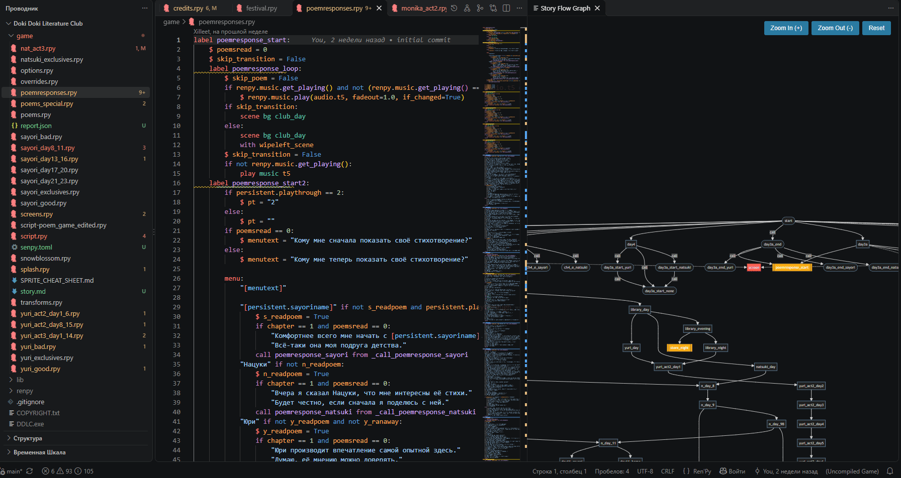
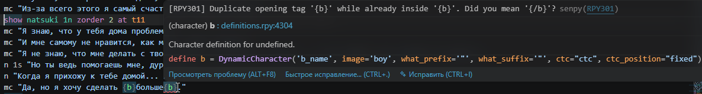
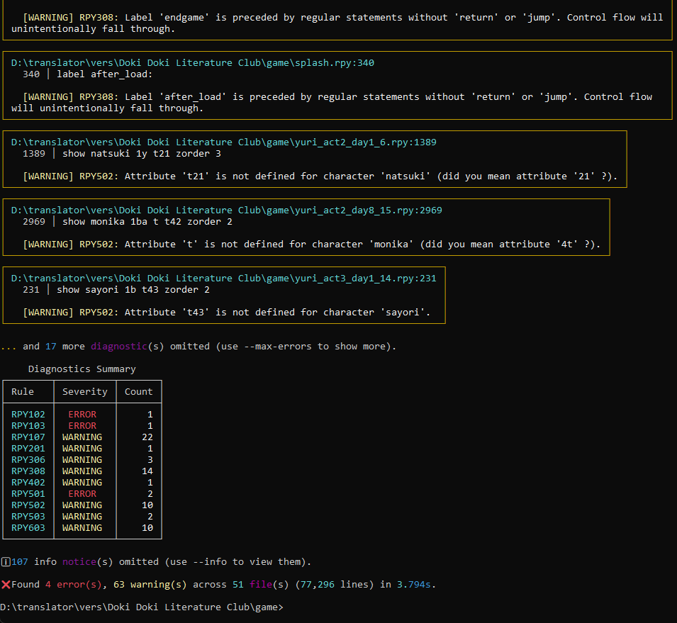
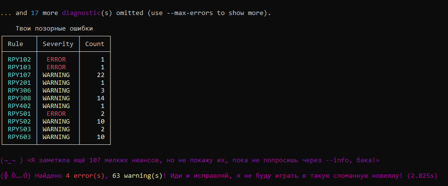
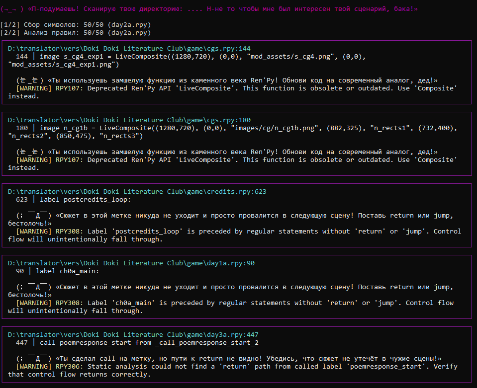

<p align="center">
  <a href="README.md"><b>English</b></a> | <a href="README_ru.md"><b>Русский</b></a>
</p>

# Senpy (`senpy-linter`)

<p align="center">
  <a href="https://www.python.org/downloads/"></a>
  <a href="https://www.renpy.org/"></a>
  <a href="LICENSE"></a>
  <br>
  
  
  <a href="https://github.com/Xilleet/senpy/actions"></a>
  <a href="RULES.md"></a>
  <a href="ARCHITECTURE.md"></a>
  <a href="https://github.com/Xilleet/senpy/actions"></a>
  <a href="https://github.com/Xilleet/senpy/actions"></a>
  <a href="https://github.com/Xilleet/senpy/actions/workflows/ci.yml"></a>
</p>

<p align="center">
  <b>"Notice me, Senpy! (⁄ ⁄>⁄ ▽ ⁄<⁄ ⁄)"</b><br>
  <i>Senpy — Fast static analyzer, semantic linter, control-flow analyzer and VS Code language server for Ren'Py visual novels. Detects undefined variables, broken labels, control-flow bugs, rollback/save issues, translation errors, and more.</i>
</p>



---

## Quick Install

**CLI / CI / Linux / macOS:**
```bash
pip install senpy-linter
```

**VS Code Extension (Windows, zero Python setup):**
Download the latest `senpy-vscode-X.X.X.vsix` from the [Releases](https://github.com/Xilleet/senpy/releases) page → Install from VSIX in VS Code.

---
## What's New

### 0.7.6 — New rules (RPY704-707, RPY801-802), rule improvements, mypy hardening, fixture coverage 100%

| Feature | Description |
|---|---|
| **6 new lint rules** | RPY704 (unused `default` variable), RPY705 (unused screen parameter), RPY706 (unused transform parameter), RPY707 (unused audio channel registration), RPY801 (duplicate translation string), RPY802 (inconsistent translation across files). Total: 49 → **51 rules**. |
| **Rule improvements** | RPY108: catches incompatible BinOp in expressions (`"text" + 5`). RPY401: concrete fix suggestion (`$ var = 0`). RPY403: tautology detection (`if x or not x:`). RPY502: case-insensitive image matching (`show Sayori` → suggests `sayori`). |
| **Fixture coverage 100%** | All 51 rules now have bad+good `.rpy` fixtures with auto-verified JSON snapshots. Was 23/45 (51%). |
| **mypy 264 → 32** | Vendor excluded, DiagnosticSink → SenpyAnalyzer (TYPE_CHECKING), pygls overrides, None guards. −88% errors. |
| **CLI flag validation** | `--fix+--check`, `--fix+--diff`, `--check+--diff` now exit with code 2 and a clear message (no traceback). Warnings for no-op combinations. |
| **CI badges always update** | Badges now update on every main push, even if a matrix test fails (via `if: always()`). No more stale green badges. |
| **Dependabot** | Weekly dependency updates for pip + GitHub Actions, grouped into single PRs. |
| **RPY902 example plugin** | `examples/todo_comment_plugin/` — detects `# TODO:`, `# FIXME:`, `# XXX:`, `# HACK:` comments. Second example plugin alongside `my_senpy_plugin` (RPY901). |

### 0.7.5 — Plugin autoload, CI hardening, BLAKE2b hash

| Feature | Description |
|---|---|
| **Plugin autoload** | Installed-and-trusted plugins are now loaded automatically when you run `senpy`, `senpy rule list/show`, or `senpy inspect`. Previously the loader pipeline existed but was never called from CLI entrypoints — plugin rules were invisible. Now `senpy rule list` after `pip install -e examples/my_senpy_plugin` shows `RPY901`. |
| **Pre-commit hook** | `.pre-commit-hooks.yaml` ships in the repo root. Add Senpy to any project using [pre-commit](https://pre-commit.com) with a 4-line config (see [Pre-commit Integration](#pre-commit-integration) below). Only `--check` (non-mutating) is exposed — `--fix` would loop on Windows CRLF. |
| **BLAKE2b cache hash** | File cache keys now use BLAKE2b instead of MD5. Faster, no security baggage. Old `.senpy_cache/cache.pkl` invalidates silently (hash mismatch → cache miss → recompute, no crash). |
| **`_RWLock` timeout** | The LSP server's read/write lock gained `acquire_read(timeout=...)` / `acquire_write(timeout=...)` so a stuck client can't hang the LSP forever. Full migration to the `readerwriterlock` library is deferred to post-1.0 (documented tradeoff). |
| **macOS Python matrix** | CI now runs Ubuntu × Windows × macOS across Python 3.11/3.12/3.13 (9 jobs), plus Python 3.14 beta on Ubuntu + Windows (experimental, `continue-on-error`). |
| **`SYSTEM_LABELS` in inspect** | `senpy inspect` no longer reports `start`, `splash_window`, `after_load`, `main_menu`, etc. as "unreferenced" — they are system labels Ren'Py calls automatically. |
| **`NON_ASSET_EXTENSIONS`** | `.rpy`, `.rpym`, `.rpyc`, `.rpa` files are no longer counted as "unused assets" by RPY503 — they are code, not media. |
| **English-only codebase** | All comments and docstrings in `senpy/` are now English (the Russian-to-English translation pass was completed in 0.7.3; 0.7.5 extends the guard to `scripts/`). The `test_no_russian_comments.py` test now scans `scripts/` too. |

### 0.7.4 — Introspection, output formats, rule metadata, strict mode, formatter rule

| Feature | Description |
|---|---|
| **`senpy inspect` subcommand** | Dumps all symbols Senpy sees in a project as JSON: labels, screens, variables, transforms, images, jump_sources (reverse index), used_assets, diagnostics, unresolved (broken jumps / missing screens / unreferenced labels / unused assets), and per-section stats. Designed for debugging hover/asset resolution and for plugin authoring. Shortcuts: `--summary`, `--unresolved`, `--label X`, `--screen X`, `--transform X`. |
| **Output formats: rdjson + gitlab** | `--output-format rdjson` (Reviewdog NDJSON — one JSON object per line, pipe into `reviewdog -f=rdjson`) and `--output-format gitlab` (GitLab Code Quality JSON array — fingerprint-stable for MR annotations). Total output formats: 7 (`text`, `json`, `sarif`, `junit`, `github`, `rdjson`, `gitlab`). |
| **`senpy rule` subcommand** | Browse rule metadata without running the analyzer: `senpy rule list [--format json] [--tag T] [--severity S]`, `senpy rule show CODE`. `--rules` and `--rule CODE` flags on the main CLI continue to work as aliases. |
| **Tags on rules** | Every rule in `RULES_DATABASE` now has a `tags` field (28 tags across 45 rules: `formatting`, `variables`, `state`, `rollback`, `deprecated`, `screen`, `assets`, `audio`, `translations`, `dead-code`, etc.). `senpy rule list --tag rollback` filters by tag (union semantics). |
| **`--tag` / `--ignore-tag` filters** | Lint mode accepts `--tag rollback state` (run only those rules) and `--ignore-tag dead-code` (silence those rules). Tag matching is case-insensitive; a rule passes `--tag` if ANY of its tags matches. |
| **`strict = true` config** | The `strict` field on `SenpyConfig` is now enforced (was documented since 0.6.0 but never read). With `strict = true`, every diagnostic whose code is NOT explicitly overridden in `[tool.senpy.severity]` is promoted to `ERROR`. Explicit severity overrides win over strict. |
| **FMT-STRING-CONSISTENCY** | 8th formatter rule (7th in code, 8th by ID). Normalizes the outer quotes of single-line string literals in CODE lines to a consistent style. Default: `'hi'` → `"hi"` (Ren'Py convention). Configurable via `string_style = "double" | "single" | "preserve"`. Dialogue and triple-quoted strings are intentionally not touched. |
| **Format Style Guide (stub)** | `docs/FORMAT_STYLE_GUIDE.md` documents the 6 original formatter rules. Full version (8 rules) lands in 0.7.6. |

### 0.7.3 — Plugin trust UX, English-only codebase, dynamic badges

| Feature | Description |
|---|---|
| **Non-interactive plugin trust** | `--trust-plugin NAME` / `--untrust-plugin NAME` CLI flags write to `~/.senpy/trusted_plugins.json` and `sys.exit(0)` without running the analyzer. Trust management is now fully scriptable. The default trust callback detects LSP mode (`--lsp` in argv) and declines untrusted plugins without prompting (no `input()` hang in LSP). |
| **English-only codebase (Russian-to-English pass)** | All Russian comments and docstrings in `senpy/` translated to English in a single mechanical pass: 52 files, ~1057 lines changed (additions = removals, no logic changes). `senpy/domain/tsundere.py` (intentional Russian easter-egg) and `senpy/vendor/` are whitelisted. `tests/test_no_russian_comments.py` guards the invariant going forward. |
| **Dynamic badges** | Five badges auto-updated by CI on every push to `main`: tests, rules (45), LSP handlers, coverage, speed. `scripts/update_badges.py` reads metrics and writes JSON files; README badges are shields.io `endpoint?url=...` pointing at raw JSON on `main`. |
| **6 new CLI flags** | `--statistics`, `--add-noqa`, `--respect-gitignore`, `--config FILE` (with `SENPY_CONFIG` env var), `--show-settings`, `--cache-dir`. |

### 0.7.2 — God-function splitting, DRY cleanup

| Feature | Description |
|---|---|
| **God-function refactoring** | 12 long functions split into focused helpers (≤60 lines each, ≤80 for dispatch tables). Notable: `_check_show_scene` (188 → 30 lines), `_check_audio_statement` (174 → 21 lines), `MermaidBuilder.build` (132 → 18 lines), `process_quoted_strings` (187 → 58 lines). All public APIs unchanged; characterization tests held. |
| **DRY helpers** | New `senpy/core/paths.py` (28 LOC) and `senpy/core/progress.py` (24 LOC) centralize `normalize_path` and `progress_print` — previously copy-pasted across modules. |
| **First dynamic badge** | The `tests` badge auto-updates on `main` via `scripts/update_badges.py`. 4 more badges arrive in 0.7.3. |

### 0.7.1 — Stabilization, dynamic badges, CONTRIBUTING refresh

| Feature | Description |
|---|---|
| **Stale API cleanup** | All `LanguageServer.show_message_log` calls (pygls 2.x removed API) replaced with `_logger.debug/warning`. Stale `build_exe.bat` and `build_vsix_dev.bat` removed. |
| **Doc-sync** | README "What's New" updated from 0.6.0 to 0.7.0; plugin example in README synced with `examples/my_senpy_plugin/`; SECURITY.md broken test links fixed. |
| **Internal-ID scrub hook** | `scripts/clean_internal_ids.py` (pre-commit hook) scrubs any leaked internal task IDs from comments, CHANGELOG, commit messages, docstrings. `tests/test_clean_internal_ids.py` locks in the contract. |
| **`warnings.filterwarnings` removal** | Module-level global filterwarnings removed from `core/analyzer.py` and `lsp/server.py`. Tests run with `-W error::SyntaxWarning` to catch silent regressions. |

### 0.7.0 — Image/Audio/Video Hover + Auto-generated API Docs

| Feature | Description |
|---|---|
| **Image Preview on Hover** | Hover over `show sayori happy` or `scene bg forest` to see an inline preview of the sprite/CG with size metadata. The PNG/JPEG/WEBP/GIF/BMP header parser is custom-written, requiring no dependency on Pillow. |
| **Audio Hover** | Hover over `play music bgm_calm` / `queue sound click` / `define audio.X = "…"` statements to see a "Play" link that opens VS Code's built-in media viewer. Aliases are resolved during indexing, not on every hover. |
| **Video Hover** | If an image or an auto-discovered file has a video extension (`.mp4`, `.webm`, `.ogv`, `.avi`, `.mkv`), the hover will display an "Open in default app" link via the new `senpy.openExternal` VS Code command. |
| **Auto-generated Ren'Py API Docs** | 754 entries have been automatically collected from Ren'Py 8.5.3 RST sources. Together with 221 curated entries, `RENPY_API_DOCS_ALL` now contains **975 symbols** — a 4.4× increase. |
| **TextMate Grammar for `.rpy`/`.rpym`** | A 270-line grammar with `source.renpy` scope, copied verbatim from [renpy-magic](https://github.com) (MIT). It covers comments, strings, Ren'Py text tags `{…}` and interpolation `[…]`, `python`/`init python` blocks, `$`-prefixed python lines, labels, screens, transforms, image definitions, say statements, numbers, and operators. |
| **Orphaned Video Detector** | `MEDIA_EXTENSIONS` has been expanded to include `.mp4`/`.avi`/`.mkv` — RPY503 (unused asset check) now flags orphaned video files as well. |

Full changelog: [CHANGELOG.md](https://github.com/Xilleet/senpy/blob/main/CHANGELOG.md)

---

## Why You Need This

`renpy lint` catches syntax errors, but does not catch the bugs that actually
ship to players. These are real bugs that Senpy would have caught before
release:

### Bug 1 — Save-breaking `define` mutation

```renpy
define player_gold = 100

label spend_gold:
    $ player_gold -= 50    # ← mutates a `define`
    "You have [player_gold] gold."
```

**Symptom:** Game works in dev. Players report `Exception: define player_gold is not revertable`
on rollback, or save files silently corrupt after loading an old save.

**Senpy catches it:** `RPY105` (define mutation) fires at lint time.

---

### Bug 2 — `NameError` after loading a save

```renpy
label start:
    jump intro

label intro:
    $ greeted = True
    "Hello!"

label continue_story:
    if greeted:    # ← `greeted` not declared with `default`
        "Hi again!"
```

**Symptom:** Game works on first playthrough. Players who load a save at
`continue_story` (skipping `intro`) hit `NameError: name 'greeted' is not defined`.

**Senpy catches it:** `RPY104` (dynamic assignment without `default`).

---

### Bug 3 — Branch asymmetry (uninitialized read)

```renpy
label branch_demo:
    menu:
        "Take the sword":
            $ has_sword = True
        "Leave it":
            pass       # ← has_sword never set in this branch

    if has_sword:       # ← MAYBE_SET read
        "You swing!"
```

**Symptom:** Game works for players who take the sword. Players who leave it
hit `NameError: name 'has_sword' is not defined` (or in rollback, the variable
silently retains a previous playthrough's value).

**Senpy catches it:** `RPY404` (reading MAYBE_SET variable) and `RPY401`
(branch asymmetry).

---

### Bug 4 — Wrong collection method (`AttributeError` at runtime)

```renpy
label add_item:
    $ inventory.add("sword")    # ← list has no .add() method
```

**Symptom:** `AttributeError: 'list' object has no attribute 'add'` the first
time a player picks up an item. Tested paths miss it; untested paths crash.

**Senpy catches it:** `RPY108` (incompatible collection method) with QuickFix
suggesting `.append()`.

---

### Bug 5 — Unused image asset (dead weight in your build)

```renpy
# 200 image definitions, only 30 ever shown on screen
image bg_old_castle = "old_castle.png"   # ← left over from cut content
image bg_old_forest = "old_forest.png"   # ← unused
```

**Symptom:** Build size balloons. Players download 500MB instead of 200MB.
Nobody notices until a Steam reviewer complains about download size.

**Senpy catches it:** `RPY701` (unused define), `RPY702` (unused transform),
`RPY703` (unused screen).

---

### Bug 6 — Translation interpolation breakage

```renpy
# game/script.rpy
$ player_name = "Hero"
"Welcome, [player_name]!"     # ← English source

# game/tl/russian/script.rpy
translate russian welcome_1:
    "Добро пожаловать, [player]!"   # ← typo: player instead of player_name
```

**Symptom:** Russian players see `Добро пожаловать, [player]!` literally
(interpolation variable doesn't exist). English build works fine.

**Senpy catches it:** `RPY601` (broken interpolation variable in translation).

---

### The pattern

Every bug above:

1. Slips past `renpy lint` (which only checks syntax + label targets).
2. Survives dev playtesting (devs always pick the "interesting" branch).
3. Surfaces only after release — via Steam reviews, Discord screenshots,
   or itch.io bug reports.
4. Costs hours of "works on my machine" debugging because the player can't
   reproduce it in front of you.

Senpy catches them at lint time — before they ship. **That's why you need it.**

For the full list of 45+ rules with examples, see **[RULES.md](https://github.com/Xilleet/senpy/blob/main/RULES.md)**.

---

## Why Senpy?

The standard built-in `renpy lint` command only checks for basic syntax errors and broken label targets. It is blind to deep runtime Python execution issues, rollback desynchronizations, and save-file corruptions. Consequently, critical `NameError` and `KeyError` crashes often slip into production builds and are only discovered after dozens of hours of manual playtesting.

**Senpy** provides comprehensive static semantic analysis without requiring the Ren'Py SDK runtime:

* **Zero-Setup Standalone VSIX:** Windows extension packages bundle a self-contained runtime — writers and narrative designers don't need Python, virtual environments, or `pip` installed.
* **High Throughput & Disk Serialization:** Analyzes **77,000+ lines in ~3.5s on cold start and 0.04s incrementally** via two-tier `.senpy_cache/` disk serialization.
* **Save Game & Rollback Safety:** Catches dangerous `define` mutations (`RPY105`), non-revertable types (`RPY106`), dynamic assignments missing `default` (`RPY104`), and type-taint conflicts (`RPY108`).
* **Init Phase Dependency Graph:** Analyzes alphabetical file loading order in `init python:` to prevent runtime `NameError` crashes on startup (`RPY109`).
* **Arity & Signature Checking:** Verifies parameter counts and keyword arguments on `call label(...)` (`RPY310`) and `use screen(...)` (`RPY207`).
* **Branching Dataflow Analysis:** Traces nested `if/elif/else` and `menu:` branches to ensure variables aren't evaluated in an uninitialized `MAYBE_SET` state (`RPY401`, `RPY404`).
* **Screen & UI Action Inspector:** Catches predictive state mutations (`RPY201`), imperative loops (`RPY205`), dead buttons (`RPY203`), function calls in actions (`RPY206`), and inspects string targets in screen Actions (`SetVariable`, `ToggleVariable`, `Show`, `ShowMenu`, `Hide`) for typos and missing declarations (`RPY202`, `RPY204`).
* **ATL Transforms & Transitions:** Validates custom and built-in positions/transforms in `show ... at <transform>` and transitions in `with <transition>`, catching runtime `NameError` typos with QuickFix suggestions (`RPY502`).
* **Collection Method Guard:** Detects incompatible method invocations on known types (`list.add()` → `.append()`, `dict.append()`, `str.pop()`) before runtime `AttributeError` crashes occur (`RPY108`).
* **Translation Validator & Coverage:** Audits `game/tl/` formatting, catches broken interpolation variables (`RPY601`), and calculates localization completion metrics via `senpy --coverage`.
* **Runtime Crash Inspector:** Parses `traceback.txt` post-mortem crash logs, explaining failures in human-readable terms (`senpy --traceback`).
* **Dead Code Detection:** Finds unused `define` constants (`RPY701`), unused `transform` definitions (`RPY702`), and unused `screen` definitions (`RPY703`).

---

## Senpy vs built-in `renpy lint`

Ren'Py ships with a built-in `lint` command (`renpy.exe lint`), but it launches the entire Pygame runtime and only catches syntax-level issues. Senpy is a standalone static analyzer that runs without the Ren'Py SDK and catches a different class of bugs.

| Aspect | Ren'Py built-in `lint` | Senpy |
|---|---|---|
| **Approach** | Launches Pygame runtime, executes `init python:` blocks | Static analysis, no SDK required |
| **Speed on 70k LOC** | 30–40 seconds | ~3.5s cold / 0.04s incremental |
| **Save / rollback safety** | ❌ | ✅ `RPY104`, `RPY105`, `RPY106` |
| **Translation mismatch detection** | ❌ | ✅ `RPY601`, `RPY602`, `RPY603` |
| **Story graph visualization** | ❌ | ✅ `senpy --graph` |
| **Dead code detection** | ❌ | ✅ `RPY701`–`RPY707` |
| **Branching dataflow analysis** | ❌ | ✅ `RPY401`, `RPY404` |
| **Init phase dependency graph** | ❌ | ✅ `RPY109` |
| **CI-ready (GitHub Actions, SARIF)** | Needs headless Ren'Py SDK in CI | `pip install senpy-linter` + SARIF output |
| **IDE integration** | ❌ | ✅ LSP for VS Code (20+ handlers) |
| **What it catches** | Syntax errors, broken `jump`/`call` targets, missing images | + Save corruption, rollback desync, translation bugs, dead code, type taint, init order |
| **Distribution** | Bundled with Ren'Py SDK | PyPI (`senpy-linter`) + Open VSX extension + GitHub Releases |

The two tools are **complementary, not replacements**. Senpy catches a class of bugs that built-in `lint` cannot see (semantic, save/rollback, translation, control-flow). Run both: built-in `lint` for SDK-level checks, Senpy for everything else.

---

## Senpy vs `vscode-language-renpy` (official extension)

`vscode-language-renpy` is the **official** Ren'Py extension for VS Code (152 ⭐, maintained by the Ren'Py team). It provides syntax highlighting and basic snippets. Senpy provides **semantic analysis** on top of that — it understands variables, control flow, screens, and translation files, not just text.

| Capability | `vscode-language-renpy` | Senpy |
|---|---|---|
| Syntax highlighting | ✅ | ✅ |
| Language configuration (brackets, comments) | ✅ | ✅ |
| Snippets | ✅ basic | ❌ |
| **Real-time diagnostics** | ❌ | ✅ 49+ rules, runs on every keystroke |
| **Go-to-definition** | ❌ | ✅ labels, screens, transforms, defines |
| **Find references** | ❌ | ✅ across the whole project |
| **Hover docs** | ❌ | ✅ renpy API + asset previews |
| **Rename symbol** | ❌ | ✅ labels, screens |
| **Semantic tokens** | ❌ | ✅ |
| **Story graph visualization** | ❌ | ✅ Mermaid diagram of branching routes |
| **Save / rollback safety checks** | ❌ | ✅ |
| **Translation validator** | ❌ | ✅ `game/tl/` mismatch detection + coverage |

The two extensions are **complementary and can be installed side-by-side**. If you want both syntax highlighting (official) and semantic diagnostics (Senpy), install both.

---

## LSP & VS Code Features

Senpy includes a full **Language Server Protocol** implementation with 20+ handlers:

| Feature | Shortcut | Description |
|---|---|---|
| **Diagnostics** | automatic | Real-time error/warning squiggles (~0.04s incremental cache) |
| **Go to Definition** | `F12` | Jump to label/screen/variable/asset definitions |
| **Hover** | hover | Docs for 220+ Ren'Py API functions |
| **Autocomplete** | `Ctrl+Space` | Labels, screens, transforms, variables, image attributes |
| **Document Symbols** | `Ctrl+Shift+O` | Outline view with labels/screens/transforms |
| **Workspace Symbol** | `Ctrl+T` | Global symbol search across all files |
| **Rename** | `F2` | Rename label → updates all `jump`/`call` references |
| **Find All References** | `Shift+F12` | All jump/call sites for a label |
| **Code Folding** | automatic | Collapse `label`/`screen`/`menu`/`init` blocks |
| **Document Highlight** | cursor | Highlight all occurrences of word in file |
| **QuickFix** | `Ctrl+.` | Auto-fix suggestions (tabs→spaces, smart quotes, unclosed tags) |
| **Color Swatches** | `0.6.0+` | Hex color literals shown as clickable color picker |
| **Format Document** | `Shift+Alt+F` | Run Senpy formatter (8 rules) |
| **Signature Help** | `0.6.0+` | Parameter hints for `call label(...)` / `use screen(...)` |
| **Call Hierarchy** | `0.6.0+` | Right-click → "Find Callers" / "Find References" |
| **Story Graph** | command | Interactive Mermaid.js flowchart of all labels and jumps |



---

## Plugin System

Senpy 0.6.0 introduces a **plugin system** — write your own lint rules as pip packages.

### Quick start

```bash
# 1. Create a plugin project (see example below)
cd examples/my_senpy_plugin
pip install -e .

# 2. Run Senpy — it discovers your plugin automatically
senpy /path/to/game
# First run: "Plugin 'my-senpy-plugin' wants to load. Trust and enable? [y/N]"
```

### Write Your Own Rule in 30 Lines

This rule (from `examples/my_senpy_plugin/`) flags dialogue lines that are not wrapped in `_()` for translation:

```python
from senpy.api import Diagnostic
from senpy.plugins import Rule, RuleContext, RuleMeta, register_rule

PLUGIN_API_VERSION = "1.0"


@register_rule("RPY901")
class HardcodedDialogueRule(Rule):
    meta = RuleMeta(
        code="RPY901",
        docs="Detects dialogue lines without _() for translation",
        severity="WARNING",
        tags=["translations", "accessibility"],
    )

    def check(self, ctx: RuleContext) -> list[Diagnostic]:
        diags = []
        for line_no, raw in enumerate(ctx.lines, start=1):
            stripped = raw.lstrip(" \t")
            if not stripped or stripped[0] not in ('"', "'"):
                continue
            if stripped.startswith('_("') or stripped.startswith("_('"):
                continue  # already translated
            diags.append(
                Diagnostic(
                    file_path=ctx.file_path,
                    line_number=line_no,
                    line_content=raw.rstrip(),
                    code="RPY901",
                    message=f"Hardcoded dialogue without _() for translation",
                    severity="WARNING",
                )
            )
        return diags
```

Full guide: **[Plugin Development README](https://github.com/Xilleet/senpy/blob/main/examples/my_senpy_plugin/MY_SENPY_PLUGIN_README.md)**

---

## Usage

```bash
# Analyze a Ren'Py game directory
senpy "path/to/game"

# Automatically apply safe fixes (unclosed tags, smart quotes, tab indents)
senpy "path/to/game" --fix

# Show what was fixed (detailed report)
senpy "path/to/game" --fix --show-fixes

# Calculate translation completion metrics
senpy "path/to/game" --coverage

# Generate project documentation (GDD / Wiki)
senpy "path/to/game" --export-wiki "PROJECT_WIKI.md"

# Generate Python type stubs (.pyi) for Pylance / MyPy
senpy "path/to/game" --stubs

# Inspect a Ren'Py runtime crash log
senpy --traceback "path/to/traceback.txt"

# One-click GitHub Actions workflow generator
senpy --init-ci

# Generate 'senpy_defaults.rpy' for missing default variables
senpy "path/to/game" --defaults

# Export story flow as Mermaid.js diagram
senpy "path/to/game" --graph-file "story_graph.md"

# Generate HTML report with interactive story graph
senpy "path/to/game" --export-html "report.html"

# Output in SARIF, JSON, JUnit XML, or GitHub Actions format
senpy "path/to/game" --output-format sarif --output-file senpy.sarif
senpy "path/to/game" --output-format json
senpy "path/to/game" --output-format junit
senpy "path/to/game" --output-format github

# List all available rules
senpy --rules

# Enable tsundere mode
senpy "path/to/game" --tsundere
```







---

## Rules Overview

Senpy includes **45 specialized semantic rules** across 8 categories:

| Series | Category | Description |
| :--- | :--- | :--- |
| **RPY0xx** | Indentation & Formatting | Tab characters (`RPY001`), smart quotes in code (`RPY002`). |
| **RPY1xx** | Variables, State & APIs | Missing `[var]` references, `NameError` on `+=`, `define` mutations, deprecated APIs (`RPY107`), type taints (`RPY108`), init load order (`RPY109`). |
| **RPY2xx** | Screens & UI | Predictive mutations (`RPY201`), dead buttons (`RPY203`), missing screens (`RPY204`), imperative loops (`RPY205`), parameter mismatches (`RPY207`). |
| **RPY3xx** | Dialogue & Story Flow | Unclosed tags (`RPY301`), broken jumps (`RPY302`), dead labels (`RPY303`), duplicate labels (`RPY307`), story islands (`RPY309`), call args (`RPY310`). |
| **RPY4xx** | Branching & Logic | Menu branch asymmetry (`RPY401`), empty choices (`RPY402`), contradictions (`RPY403`), `MAYBE_SET` reads (`RPY404`). |
| **RPY5xx** | Assets & Media | Missing audio (`RPY501`), unresolved sprites (`RPY502`), unused assets (`RPY503`), unregistered channels (`RPY505`). |
| **RPY6xx** | Translations | Variable mismatches (`RPY601`), tag mismatches (`RPY602`), empty strings (`RPY603`). |
| **RPY7xx** | Dead Code | Unused `define` (`RPY701`), unused `transform` (`RPY702`), unused `screen` (`RPY703`). |

Full descriptions, rationale, and examples: **[RULES.md](https://github.com/Xilleet/senpy/blob/main/RULES.md)**

---

## Configuration (`senpy.toml`)

```toml
[tool.senpy]
decompile = true
max_errors = 50

ignore = [
    "RPY104",  # Dynamic assignments without default
    "RPY303",  # Unreferenced labels (dynamic routers)
]

[tool.senpy.severity]
RPY104 = "ERROR"   # Elevate to build-breaking
RPY308 = "INFO"    # Demote fallthrough to info
```

### Inline Suppression (`# noqa`)

```renpy
"Warning: {b}unclosed style"  # noqa
$ dynamic_var = 1             # noqa: RPY104
```

### Project-level Suppression (`.senpy-ignore`)

For bulk rule exclusions, create a `.senpy-ignore` file in the project
root (next to `senpy.toml`). Each line is a rule code to suppress:

```text
# .senpy-ignore — one rule code per line
RPY101  # typo in dialogue variable
RPY104
# RPY105  # commented out — rule will fire
RPY301
```

Lines starting with `#` are comments. Inline comments (after the rule
code) are allowed. Codes are case-insensitive (normalized to uppercase).

---

## GitHub Actions Integration

```bash
senpy --init-ci  # generates .github/workflows/senpy.yml
```

Or manually create `.github/workflows/senpy.yml`:

```yaml
name: Senpy Code Scanning
on:
  pull_request:
    branches: [ "main", "master" ]
jobs:
  lint:
    runs-on: ubuntu-latest
    permissions:
      security-events: write
      contents: read
    steps:
      - uses: actions/checkout@v4
      - uses: actions/setup-python@v5
        with:
          python-version: "3.11"
      - run: pip install senpy-linter
      - run: senpy game/ --output-format sarif --output-file senpy.sarif
        continue-on-error: true
      - uses: github/codeql-action/upload-sarif@v3
        with:
          sarif_file: senpy.sarif
```

---

## Pre-commit Integration

Senpy ships a [pre-commit](https://pre-commit.com) hook that runs
`senpy --check` on every commit. Add this to your `.pre-commit-config.yaml`:

```yaml
repos:
  - repo: https://github.com/Xilleet/senpy
    rev: v0.7.5   # use the latest tag
    hooks:
      - id: senpy
```

The hook is **non-mutating** — it only reports issues, never auto-fixes
them. This is deliberate: an auto-fixing hook combined with git's
`autocrlf` on Windows creates an infinite loop (the formatter
normalizes line endings, git converts them back, the formatter runs
again). Run `senpy --fix` manually if you want auto-fixes.

---

## Safe Sandbox Decompilation

When analyzing game distributions or mods without source code, Senpy detects standalone `.rpyc` files:

1. Copies `.rpyc` into an isolated OS temporary directory.
2. Prompts to download `unrpyc` automatically if not present.
3. Analyzes decompiled scripts entirely within the sandbox.
4. Cleans up — your project directory stays unmodified.

---

## Troubleshooting: Common Errors Caught by Senpy

Senpy catches runtime crashes before you launch the game. Here are common errors and the Senpy rules that prevent them:

| Runtime Error | Senpy Rule | What it catches |
| :--- | :---: | :--- |
| `NameError: name 'x' is not defined` on load | `RPY104` | `$ x = 1` inside a label without a top-level `default x = 0` — variable won't survive save/load |
| `NameError: name 'x' is not defined` in `if` | `RPY103` | `if x:` where `x` was never declared via `default` or `define` |
| `NameError: name 'x' is not defined` after `menu` | `RPY401` | Variable defined in one `menu:` branch but missing in another — crashes if player picks the wrong path |
| `NameError` on game launch (`init` phase) | `RPY109` | Function/class used in `init python:` before it's defined (alphabetical file load order violation) |
| `KeyError: 'player_name'` in dialogue | `RPY101` | Typo in `[player_name]` interpolation — variable doesn't exist |
| `KeyError` in translation string | `RPY601` | Translation `new "..."` has different `[var]` than original `old "..."` |
| `TypeError: unsupported operand type(s) for +=` | `RPY108` | Type taint conflict (e.g., `str += int`) or invalid method like `list.append()` on a `dict` |
| `AttributeError: 'list' object has no attribute 'add'` | `RPY108` | Wrong method on collection type (e.g., `my_list.add()` instead of `.append()`) |
| `ScriptError: Label 'xxx' is not defined` | `RPY302` | `jump xxx` or `call xxx` to a label that doesn't exist |
| `SyntaxError: tab/indent mismatch` | `RPY001` | Tab characters in indentation (Ren'Py requires 4 spaces) |
| Game crashes after loading a save | `RPY104` / `RPY105` | Variable created with `$` instead of `default`, or `define` constant mutated |
| Screen UI freezes / FPS drops | `RPY201` / `RPY205` | Direct state mutation inside screen or heavy `for`/`while` loops in screen language |

> **Tip:** Run `senpy path/to/game --fix` to auto-fix the safe ones (`RPY001`, `RPY002`, `RPY301`), or use **QuickFix** (`Ctrl+.`) directly in VS Code.

---

## Contributing

Contributions, bug reports, and rule suggestions are welcome.

1. Fork the repository.
2. Create a feature branch (`git checkout -b feature/NewRule`).
3. Commit your changes (`git commit -m 'feat: add RPY901 check'`).
4. Ensure test suite passes (`pytest`).
5. Open a pull request.

Want to write a plugin instead of contributing to core? See the **[Plugin Development Guide](https://github.com/Xilleet/senpy/blob/main/examples/my_senpy_plugin/MY_SENPY_PLUGIN_README.md)**.

---

## About Senpy

Senpy is a passion project — I needed a semantic linter for my own Ren'Py
visual novel, and none existed. So I built one.

**How it's made:** I read and review Python code fluently, but I don't enjoy
typing boilerplate. So I let AI tools do the typing, while I do:

- Architecture (what rules to add, how the LSP server should work)
- Code review (every line — I catch bugs the AI misses)
- Testing on real Ren'Py projects
- Bug report triage and fixes
- Release management

The AI doesn't decide what to build, doesn't push code, doesn't choose
features. I do. The AI is my fast typist.

If you're curious about this workflow, I'm happy to discuss in
[Discussions](https://github.com/Xilleet/senpy/discussions). If you find a
bug, [report it](https://github.com/Xilleet/senpy/issues) — I read every
issue and fix what matters to users.

Also check out [ScreenTale](https://github.com/Xilleet/ScreenTale), another
tool from me.

---

## Other projects named "senpy"

The name `senpy` is shared with several unrelated projects. If you landed here looking for one of those, here's a disambiguation:

| Project | What it is | Link |
|---|---|---|
| **Senpy (this repo)** | Semantic linter and static analyzer for Ren'Py visual novels | https://github.com/Xilleet/senpy |
| `pypi.org/project/senpy` | Sentiment analysis server (Marl/Onyx/NIF vocabularies) | https://pypi.org/project/senpy/ |
| `ACasey13/senpy` | Python package for Neyer sensitivity testing | https://github.com/ACasey13/senpy |
| SCIA Engineer `senpy` | Python framework to generate SCIA Engineer XML data | https://www.scia.net/en/support/addons/senpy-python-framework-generate-scia-engineer-data |
| *Senpy: A framework for semantic sentiment and emotion* | Academic paper, ScienceDirect | https://www.sciencedirect.com/science/article/abs/pii/S0950705119305313 |

This project (`Xilleet/senpy`) is the only one related to Ren'Py. The naming collision is unfortunate — if you came here from a search for sentiment analysis or sensitivity testing, please follow the corresponding link above.

---

## License

Distributed under the MIT License. Free for commercial and non-commercial visual novel development.
