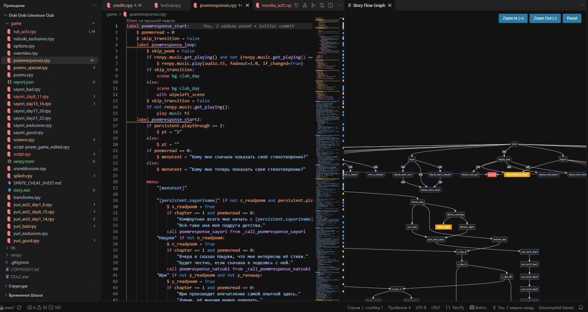
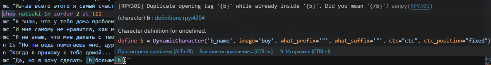
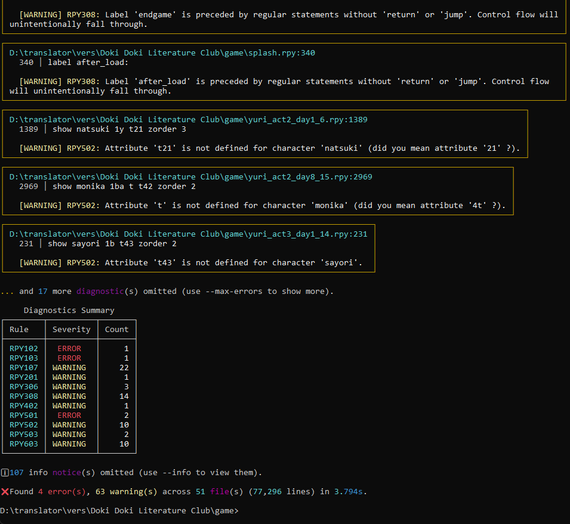
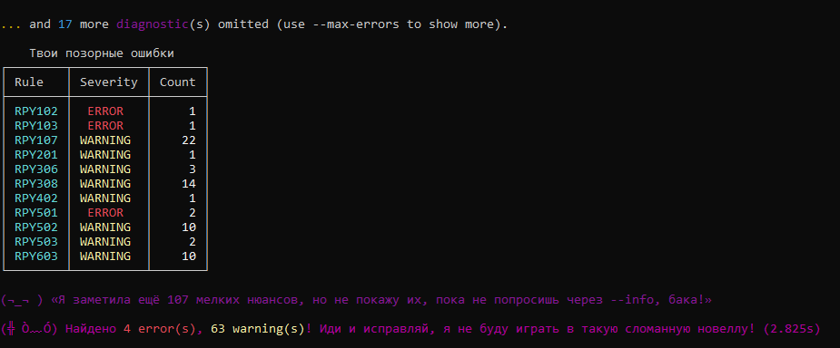
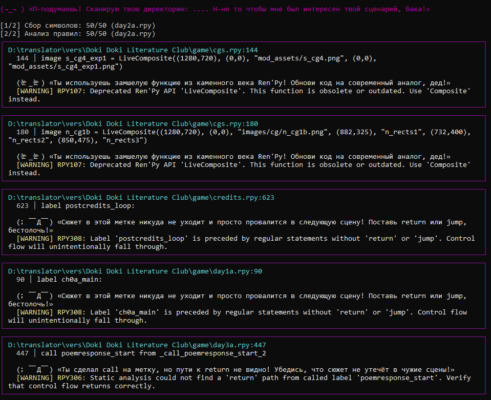

<p align="center">
  <a href="README.md"><b>English</b></a> | <a href="README_ru.md"><b>Русский</b></a>
</p>

# Senpy (`senpy-linter`)

<p align="center">
  <a href="https://www.python.org/downloads/"></a>
  <a href="https://www.renpy.org/"></a>
  <a href="LICENSE"></a>
  <br>
  
  
  <a href="https://github.com/Xilleet/senpy/actions"></a>
  <a href="RULES.md"></a>
  <a href="ARCHITECTURE.md"></a>
  <a href="https://github.com/Xilleet/senpy/actions"></a>
  <a href="https://github.com/Xilleet/senpy/actions"></a>
  <a href="https://github.com/Xilleet/senpy/actions/workflows/ci.yml"></a>
</p>

<p align="center">
  <b>«Notice me, Senpy! (⁄ ⁄>⁄ ▽ ⁄<⁄ ⁄)»</b><br>
  <i>Senpy — быстрый статический анализатор, семантический линтер, инструмент для анализа потока управления, а также языковой сервер для VS Code, предназначенный для визуальных новелл на движке Ren'Py. Позволяет обнаруживать неопределенные переменные, неработающие метки (labels), ошибки в логике потока управления, проблемы с откатом (rollback) или сохранением игры, ошибки в переводах и многое другое.</i>
</p>



---

## Быстрая установка

**CLI / CI / Linux / macOS:**
```bash
pip install senpy-linter
```

**Расширение для VS Code (Windows, без установки Python):**
Скачайте `senpy-vscode-X.X.X.vsix` со страницы [Releases](https://github.com/Xilleet/senpy/releases) → Установить из VSIX в VS Code.

---

## Статус: заморозка фичей → 1.0

Senpy 0.9.2 production-stable для пользователей. До 1.0 фокус — на
hardening архитектуры и стабилизации контракта `senpy.api` —
**без новых правил, без новых фичей, без новых форматов вывода**.

Почему: ядро накопило architectural debt, на который changelog намекает. Симптомы видны в коде: facade-врапперы в `analyzer.py`,
стирающие типизацию, LSP-стейт в module-level globals (97
cyclic-import workarounds через `TYPE_CHECKING` / lazy import),
oversized-модули (`python_ast.py` 1772 строки, `lsp/handlers/navigation.py`
разбит на 6 sub-modules в 0.6.0), тесты, coupled с internals (485 импортов из
`senpy.core/rules/cli/lsp` против 18 из публичного `senpy.api`).
Хочу закрыть это системно до объявления 1.0 API stability.

**Что принимается во время заморозки:** bug fixes, false-positive
репорты, security advisories, улучшения документации.

**Что отложено до post-1.0:** новые правила (расширение RPY0xx–RPY8xx,
RPY9xx plugin ecosystem), новые форматы вывода, новые CLI-генераторы,
расширение форматтера, sandbox R&D, editor-клиенты вне VS Code.

---

## Что нового

### 0.9.2 — Совместимость с Ren'Py 8.6.1 + 25 критических фиксов (patch)

Patch-релиз: **совместимость с Ren'Py 8.6.1** (обновление данных + auto-extract `BUILTIN_SYMBOLS` + расширение `DEPRECATED_APIS`) + **25 багфиксов** из roadmap 0.9.5. После обновления данных 8.6.1 стало ясно, что «только compat»-патч не даст пользователям причины апгрейдиться — поэтому 5 кластеров высокоэффективных низко-рискованных фиксов были перенесены в 0.9.2.

| Область | Что было сломано | Что изменилось |
|---|---|---|
| **Обновление данных Ren'Py 8.6.1** | API данные запинены на 8.5.3; новый `config.add_to_special_directories` (multiple search directories в 8.6) отсутствовал. | `renpy_api_source.yaml` теперь ссылается на `8.6.1.26111705`. `renpy_api_generated.json` перегенерирован (755 entries, +1). Новый скрипт `scripts/diff_renpy_api.py` генерирует `docs/renpy_api_diff.md` с добавленными/удалёнными/изменёнными entries между двумя JSON-снапшотами. |
| **`BUILTIN_SYMBOLS` auto-extract из JSON** | Каждый раз, когда Ren'Py добавлял новый runtime namespace, RPY202 срабатывал до того, как maintainer замечал. Namespace `preferences` (37 entries в 8.6.1) отсутствовал полностью. | `senpy/core/renpy_builtins.py` теперь извлекает top-level namespace roots (`config`, `gui`, `build`, `renpy`, `persistent`, `preferences`, `layeredimage`) из сгенерированного JSON при загрузке модуля. Новые namespaces появляются автоматически при следующем bump — без ручного редактирования. |
| **`DEPRECATED_APIS` расширен `im.*`** | Все 18 `im.*` функций/методов (deprecated с Ren'Py 7.4.0) не флагались RPY107. | 8 `im.*` функций + 10 `im.matrix.*` методов + `config.images_directory` (superseded в 8.5.0) теперь флагаются RPY107 с конкретным советом по замене на Transform-property. Всего: 15 → 34 deprecated entries. |
| **FIPS-safe MD5 в GitLab renderer** | `hashlib.md5()` без `usedforsecurity=False` падал на FIPS-системах (RHEL/Fedora), роняя весь GitLab Code Quality renderer. | `hashlib.md5(..., usedforsecurity=False)` — один keyword-аргумент, доступен с Python 3.9+. |
| **Cross-process lock для trust store** | Concurrent LSP + CLI (или два параллельных CLI) теряли grants: P1 читает {A}, P2 читает {A}, P1 пишет {A,B}, P2 пишет {A,C} → B молча потерян. | `senpy/plugins/security.py` теперь защищает read-modify-write цикл cross-process file lock (`fcntl.flock` POSIX / `msvcrt.locking` Windows), тот же паттерн что в `CacheManager`. |
| **Plugin audit ловит `importlib.import_module`** | `importlib.import_module("os").system("...")` обходил audit — современная замена `__import__()` не флагалась. | `importlib` добавлен в `_DANGEROUS_IMPORTS`, `import_module` в `_DANGEROUS_MODULE_ATTRS`. |
| **`bool` arithmetic теперь numeric** | `True + 1`, `True * 3`, `bool += int`, `True - False` триггерили RPY108. `bool` — subtype `int` в Python (True == 1, False == 0). | `bool` добавлен в numeric type set в `_infer_binop` / `_check_binop_incompatible`. Результат bool+numeric — `int` (по семантике Python: `True + True == 2`, не `True`). |
| **`dict.keys()`/`values()`/`items()` не `list`** | `$ ks = d.keys(); $ ks.append(x)` считался валидным — но `dict_keys` не имеет `append()`, runtime crash. | Возвращает `None` (unknown type), RPY108 обрабатывает консервативно. |
| **LSP word extractor Unicode-aware везде** | F12 работал на non-ASCII labels (`золото`, `はじめ`), но Shift+F12 / F2 / call hierarchy / document highlight / workspace symbol молча ничего не делали — 5 inline ASCII-only regex копий. | Все 5 копий делегируют к canonical `_word_at_position` в `_shared.py`. Off-by-one на границе слов тоже пофикшен. |
| **`progress_print` guard stdout в LSP mode** | Случайный `progress_print` из LSP-контекста коррумпировал JSON-RPC transport, editor рвал соединение. | `progress_print` no-op когда `SENPY_LSP=1` (устанавливается `start_lsp()`) или когда stdout не TTY. |
| **`init_ci_workflow` не перезаписывает молча** | `senpy --init-ci` на проекте с существующим `.github/workflows/senpy.yml` затирал ручные правки (дополнительные steps, matrix, env vars). | Новый `--force` CLI флаг требуется для перезаписи. Без него файл остаётся нетронутым, печатается WARNING. `was_created` return value честно отражает, был ли файл записан. |
| **`init_ci_workflow` пинит Senpy version + добавляет gate step** | `pip install --upgrade senpy-linter` в workflow означал, что каждый CI run подхватывал последний Senpy (~2 релиза/день), churn SARIF outputs и наборы правил. Также не было CI gate — `continue-on-error: true` на scan step означал, что CI никогда не падал на ERROR-severity diagnostics. | Workflow теперь использует `pip install senpy-linter==<version>` (запинено). Новый `--errors-only` gate step (без `continue-on-error`) падает CI на ERROR-severity diagnostics — SARIF step сохраняет `continue-on-error`, чтобы отчёт загружался даже при найденных issues. |
| **`init_ci_workflow` выводит `scan_target` из `target_path`** | `senpy --init-ci path/to/my/game` в монорепо генерировал workflow со scan target `.` (весь репозиторий). Пути с пробелами (`My Games/foo`) рвали shell команду. | `scan_target` теперь repo-relative форма `target_path`. `shlex.quote()` нейтрализует пробелы. |
| **`__version__.py` MAJOR/MINOR/PATCH выведены из `__version__`** | Три независимых hardcoded int'а — кто менял только `__version__`, оставлял MAJOR/MINOR/PATCH на старых значениях, `CacheManager.compute_environment_fingerprint` (хеширует `MAJOR.MINOR`) производил неправильные хеши. | `MAJOR, MINOR, PATCH = (int(x) for x in __version__.split("."))` — выведены, всегда синхронны. |
| **LSP generation-counter thread-safe** | `full_generation += 1` не атомарный в Python — два concurrent `schedule_full_diagnostics` могли оба load 5, оба store 6, оба proceed с `new_gen=6`, обходя stale-worker guard. | Оба generation counter'а (`full_generation` и per-URI `change_generations`) теперь под `_lsp_server._generation_lock`. `new_gen` захватывается внутри lock, так что два concurrent caller'а никогда не получат одинаковое значение. |
| **`SymbolTable.rebuild_from_scopes` чистит 3 реестра** | `transforms`, `screen_action_jumps`, `used_screens` не чистились перед update loop — plugin или LSP fast-path extension без prior `reset()` накапливал stale entries. | Все три реестра теперь чистятся перед update loop. |
| **HTML report + LSP null-guard `line_content`** | `diag.line_content.strip()` на `None` (project-level diagnostics, или rules забывшие поле) ронял HTML report / LSP `publishDiagnostics` для файла. | `(diag.line_content or "").strip()` в `html_report.py`, `raw_text = diag.line_content or ""` в `lsp/server.py`. |
| **Mermaid sanitizer расширен** | `_add_screen_use_edges` был единственным edge builder без `_mermaid_safe_id()` — screen с именем `preferences.audio` или `end` ломал diagram. | Оба `src` и `tgt` теперь санируются. `_MERMAID_RESERVED_IDS` расширен с `{"end"}` до 9 keywords. |
| **`screen.py` маскирует string literals перед `action` regex** | `textbutton "Read the action Function(x) docs":` давал false-negative RPY203 (слово "action" в dialogue) и false-positive RPY206 (`Function(` из dialogue). | `strip_string_literals(stripped)` перед обоими regex. |
| **`deprecated.py` skip'ает inline comments** | `$ x = LiveComposite()  # uses LiveComposite` давал ДВА RPY107 (один для call, один для слова в комментарии). | `_strip_comment` из `text_utils` определяет границу комментария; matches после неё игнорируются. |
| **`reset` убран из `BUILTIN_SYMBOLS`** | `reset` — transform property (используется в ATL как `transform: reset`), не position name — RPY103/RPY202 не флагали `$ reset = 5`. | Убран. (`default` оставлен — это и keyword, и валидное position name: `show layer master at default`.) |
| **JSON `sort_keys=True` в `rule_dispatch` и `gitlab`** | Non-deterministic key order ломал CI snapshot testing — два run'а на одном проекте могли дать разный JSON, если порядок plugin registration менялся. GitLab docstring обещал «sorted dict keys», но не передавал `sort_keys=True`. | Оба теперь используют `sort_keys=True`, соответствуя `inspect_dispatch.py`. |
| **Pre-commit ruff pin bumped до v0.17.6** | UP038 rule был deprecated в ruff 0.10 и удалён в 0.13.0 — предыдущий pin (v0.7.4) всё ещё enforced его (29 violations), блокируя коммиты. | Pin bumped. `ruff-format` hook оставлен на v0.7.4, чтобы избежать one-shot переформатирования 75 файлов (отдельная задача). |
| **Local `clean-internal-ids` pre-commit hook** | Не было автоматической проверки, предотвращающей утечку internal task IDs (шаблоны вида `DOC-N`, `FIX-N`) в user-facing файлы. | Новый local hook запускает `scripts/clean_internal_ids.py --dry-run` на каждый коммит. |

**Дополнительно**: 3 unrpyc импорта добавлены в `senpy.__all__`;
`senpy.api` migration guide разрешён (больше не называет
`from senpy import SenpyAnalyzer` "deprecated"); docstrings на
`SenpyAnalyzer.__init__`, `Diagnostic`, `FileScope`, `SignatureInfo`,
`LabelSymbol`; `LabelSymbol.jump_sources` → `incoming_jumps`;
`_check_unreachable_labels` → `_check_post_analysis_flow`;
`CONTRIBUTING.md` полный аудит; `README.md` бейдж обновлён до 8.6;
честная документация `.rpa` архивов; stale комментарии почищены
(P3-1, `enable_plugins` flip, `BaseException` docstring,
`T-003`/`T-004`/`T-024 in WORKLOG` ссылки); 10 ruff false-positive
noqa warnings почищены; `pyproject.toml` Python classifiers обновлены
(3.11/3.12/3.13/3.14).

Полные детали в [`CHANGELOG.md`](CHANGELOG.md#092).

---

### 0.9.1 — Активация plugin audit + branch-clear фикс + cache stress тесты + аудит доков (patch)

Patch-релиз: закрыты **3 задачи** из roadmap 0.9.0, плюс полный аудит документации.

| Область | Что было сломано | Что изменилось |
|---|---|---|
| **Активация plugin import-time audit** | AST-based audit-сканер (`senpy/plugins/audit.py`) существовал в кодовой базе, но не был подключён к pipeline загрузки — пользователи не видели warnings перед `[y/N]` trust prompt, даже для плагинов с `subprocess.run` или `eval()`. | `load_plugin()` теперь запускает audit при первой загрузке (когда плагин ещё не доверен), сохраняет warnings в trust store `audit_warnings` (schema v2, подготовлена в 0.9.0), показывает их в stderr перед trust prompt. При повторных загрузках audit skip'ается (сохраняются оригинальные warnings, avoids re-scanning при каждом запуске). Re-audit через `senpy --untrust-plugin NAME && senpy --trust-plugin NAME`. |
| **Branch-clear (MAYBE_SET через nested menu)** | Когда `menu:` choice body содержал NESTED `menu:`, рекурсивный вызов `analyze_menu_flow` НЕ получал `already_guaranteed` родителя — переменные, объявленные до внешнего menu, повторно флагались как MAYBE_SET внутренним menu. False-positive RPY404 на pre-declared переменные. | `_parse_menu_choices`, `_analyze_choice_body` и рекурсивный `analyze_menu_flow` теперь все пробрасывают `already_guaranteed`. Pre-block переменные propagируются в nested menus, чтобы внутренний `merge_flow_branches` корректно их исключал из MAYBE_SET. |
| **Cross-process cache lock stress тесты** | `fcntl`/`msvcrt` lock в `cache.py` был реализован и unit-tested (in-process через threads), но ни один тест не запускал реальные параллельные subprocess'ы на одном проекте — actual pre-commit+LSP / two-terminals / CI-matrix workload. | Новый `tests/core/test_cache_lock_stress.py` (6 тестов) спавнит 5–10 реальных `python -m senpy.cli` subprocess'ов параллельно через `subprocess.Popen` и проверяет: no crash, no leftover `.tmp` files, no corrupt `cache.pkl`, warm run succeeds. Отдельный CI job в `release.yaml`. |
| **: Полный аудит CONTRIBUTING.md** | Файл дрейфовал с 0.6.x: таблица fixture coverage перечисляла правила (RPY201/202/203/205/301/401/403/404/502/505) как "missing" (все 53 теперь имеют fixtures), project layout указывал `cli/main.py` как "1163 lines, god-module" (реально 103), `core/analyzer.py` как "1817 lines" (реально 749), checker example был function-based (реальные checkers — classes), rule registration указывал на неправильный файл. | Полный rewrite: 11 секций, 7 конкретных "good first issues" scoped к заморозке, точный project layout со всеми ~30 missing файлами, корректный class-based checker pattern, новая секция "How to add a new fixture". |

**Дополнительно**: `SECURITY.md` обновлён в present-tense для R-P0-1
(audit теперь активен, не "tracked as R&D"). `docs/comparison.md` и
`docs/renpy-vscode-extension.md` claim про semantic tokens исправлен
(❌ planned, не ✅).

Полные детали в [`CHANGELOG.md`](CHANGELOG.md#091).

---

### 0.9.0 — Security hardening + soundness + FP-фиксы из фидбэка пользователей

Minor-релиз: закрыты **6 задач** из post-0.8.4 плюс
**4 false-positive фикса** из фидбэка. Два новых
public API:
- **Trust store schema v2** с авто-миграцией из v1 — добавлено
  поле `audit_warnings` для plugin import-time audit (активирован в 0.9.1).
- **Runtime-расширение Ren'Py builtins через `senpy.toml [tool.senpy]`**
  — списки `additional_builtins` / `additional_actions` позволяют
  объявлять сторонние namespace'ы (например `iap`, `updater`) и
  кастомные Action-классы, чтобы RPY202 / RPY103 / RPY206 на них не
  срабатывали.

**1964 теста** (было 1836 в 0.8.4, +128). Новых правил нет — все
изменения: correctness-fixes, security-hardening и инфраструктура для
plugin audit / branch-clear / cross-process cache lock (все закрыты в 0.9.1).

| Область | Что было сломано | Что изменилось |
|---|---|---|
| **Trust store schema** | Нет versioning schema — любое изменение формата молча «обнуляло» trust для всех ранее доверенных плагинов. | Schema bumped to v2, auto-migration при чтении, добавлено поле `audit_warnings` для R-P0-1. |
| **Унификация терминаторов** | Три источника правды: `RE_TERMINATOR` (вкл. `call`) и два inline-regex'а в `state.py` / `flow.py` (без `call`). Могли разойтись. | `RE_BRANCH_TERMINATOR` вынесен в `core/constants.py`. Inline regex'ы заменены. Поведение не изменилось (чистый refactor). |
| **Severity RPY000** | Синтетический `RPY000` («Senpy internal error») отсутствовал в `RULES_DATABASE` — `senpy rule show RPY000` печатал "Unknown rule code", а `_apply_severity` понижал до WARNING. | Зарегистрирован в `RULES_DATABASE` с `severity=ERROR` и `tags=["internal"]`. `senpy rule list` показывает отдельную секцию "Internal". RULES.md получил секцию "Internal (RPY000)". |
| **`generate_defaults_file` error handling** | `open(out_file, "w")` без try/except — `OSError` (read-only `game/`, disk full, path too long) валил CLI с raw traceback. | Ловит `OSError`, логирует WARNING, записывает `failed_writes`, возвращает `("", 0)`. Exit code = 1. |
| **`_write_fixed_file` UnicodeEncodeError** | Ловил только `OSError` — `--fix`-ран с lone surrogate поднимал `UnicodeEncodeError`, классифицировался как RPY000, exit code 0. | Ловит `(OSError, UnicodeEncodeError)`. Atomic write через `tempfile.mkstemp` + `os.replace`. Read-only файлы детектируются заранее. |
| **RPY202 FP на `achievement.X`** | `BUILTIN_SYMBOLS` не содержал `achievement` — Ren'Py ships it as runtime-provided namespace. Добавлен. | Ren'Py builtins консолидированы в `senpy/core/renpy_builtins.py` (single source of truth). Расширение через `senpy.toml additional_builtins`. |
| **RPY206 FP на `GamepadCalibrate()`** | `BUILTIN_ACTIONS` не содержал `GamepadCalibrate` — задокументированный Ren'Py action. Добавлен. | Та же консолидация в `renpy_builtins.py`. Расширение через `additional_actions`. |
| **RPY202 FP на tuple-unpacking for-loops в screens** | `RE_FOR_LOOP` regex матчил только `for x in ...:` (один идентификатор) — silently пропускал `for i, (a, b, c) in enumerate(...)`. | AST-based хелпер `extract_for_targets` в `text_utils.py` покрывает все Python for-target shapes. |
| **RPY103 FP на for-loop targets в `init python:` / label body** | For-loop targets регистрировались только внутри screens; `init python:` и label bodies их пропускали. RPY103 срабатывал на `if fn.lower()...:` внутри `for fn in ...:`. | `extract_for_targets` интегрирован в три точки: `StateChecker.check_line`, `_check_python_block`, `_check_python_inline`. Плюс `_handle_init_python_block` теперь принимает `scope_stack`. |
| **`init python hide:` не распознавался `RE_INIT_PYTHON_START`** | Regex не включал `hide` keyword — `init python hide:` блоки молча падали в per-line `check_line` dispatch вместо AST-анализа. | Добавлен `(?:\s+hide)?` в паттерн. RPY110 (Python syntax error) теперь срабатывает и в `init python hide:` блоках. |
| **RPY103/RPY202 stacked дубликаты диагностик** | Одна переменная, упомянутая N раз в одном if-condition, давала N диагностик на одной строке — все на колонке первого вхождения. Визуально: одна squiggly на неправильной колонке. | `seen` set в `_check_undeclared_vars_in_condition` — каждая пара (line, var_name) даёт максимум одну диагностику. Разные undeclared vars всё ещё получают свои. |

**Дополнительно**: atomic writes в `CacheManager.save_manifest` и
`_write_trust_store` (устранён race при конкурентных вызовах), фикс
LSP `Timer.cancel()` race через generation counter, LSP
`autoload_plugins` в `start_lsp()`, тесты cache invalidation при
branch-switch, тест JPEG long APP markers, фикс конфликта docs deps
(`pymdown-extensions` 13.0), удалён мёртвый `_purge_file_symbols`,
фикс обработки UTF-8 BOM.

Полные детали в [`CHANGELOG.md`](CHANGELOG.md#090).

---

## Почему вам это нужно

`renpy lint` ловит синтаксические ошибки и ошибки ссылок, но баги, которые
действительно доходят до игроков, выходят за рамки его проверки. Ниже — реальные баги, которые Senpy поймал
бы ещё на этапе линтера, до релиза:

### Баг 1 — Поломка сейвов через мутацию `define`

```renpy
define player_gold = 100

label spend_gold:
    $ player_gold -= 50    # ← мутирует `define`
    "У вас [player_gold] золота."
```

**Симптом:** В дев-сборке всё работает. Игроки получают
`Exception: define player_gold is not revertable` при откате, либо файлы
сохранений тихо повреждаются после загрузки старого сейва.

**Senpy ловит:** `RPY105` (мутация define) срабатывает на этапе линтера.

---

### Баг 2 — `NameError` после загрузки сейва

```renpy
label start:
    jump intro

label intro:
    $ greeted = True
    "Привет!"

label continue_story:
    if greeted:    # ← `greeted` не объявлен через `default`
        "Привет снова!"
```

**Симптом:** В первом прохождении всё работает. Игроки, загрузившие сейв
на `continue_story` (минуя `intro`), получают
`NameError: name 'greeted' is not defined`.

**Senpy ловит:** `RPY104` (динамическое присваивание без `default`).

---

### Баг 3 — Асимметрия веток (чтение неинициализированной переменной)

```renpy
label branch_demo:
    menu:
        "Взять меч":
            $ has_sword = True
        "Не брать":
            pass       # ← has_sword не присвоен в этой ветке

    if has_sword:       # ← чтение MAYBE_SET
        "Вы замахиваетесь!"
```

**Симптом:** Работает у игроков, взявших меч. Игроки, прошедшие вторую
ветку, получают `NameError: name 'has_sword' is not defined` (или при откате
переменная тихо сохраняет значение из предыдущего прохождения).

**Senpy ловит:** `RPY404` (чтение MAYBE_SET-переменной) и `RPY401`
(асимметрия веток).

---

### Баг 4 — Неверный метод коллекции (`AttributeError` в рантайме)

```renpy
label add_item:
    $ inventory.add("sword")    # ← у list нет метода .add()
```

**Симптом:** `AttributeError: 'list' object has no attribute 'add'` при
первой попытке игрока подобрать предмет. Протестированные пути это обходят;
нетестированные — падают.

**Senpy ловит:** `RPY108` (несовместимый метод коллекции) с QuickFix,
предлагающим `.append()`.

---

### Баг 5 — Неиспользуемые ассеты (лишний вес в сборке)

```renpy
# 200 определений image, на экране показывается только 30
image bg_old_castle = "old_castle.png"   # ← осталось от вырезанного контента
image bg_old_forest = "old_forest.png"   # ← не используется
```

**Симптом:** Размер сборки раздувается. Игроки качают 500 МБ вместо 200 МБ.
Никто не замечает, пока рецензент в Steam не пожалуется на размер загрузки.

**Senpy ловит:** `RPY701` (неиспользуемый define), `RPY702` (неиспользуемый
transform), `RPY703` (неиспользуемый screen).

---

### Баг 6 — Поломка интерполяции в переводах

```renpy
# game/script.rpy
$ player_name = "Герой"
"Welcome, [player_name]!"     # ← английский оригинал

# game/tl/russian/script.rpy
translate russian welcome_1:
    "Добро пожаловать, [player]!"   # ← опечатка: player вместо player_name
```

**Симптом:** Русскоязычные игроки видят `Добро пожаловать, [player]!`
буквально (переменная интерполяции не существует). Английская сборка
работает нормально.

**Senpy ловит:** `RPY601` (битая переменная интерполяции в переводе).

---

### Закономерность

Каждый из багов выше:

1. Проходит мимо `renpy lint` (который фокусируется на синтаксисе и
   ссылках).
2. Выживает в дев-плейтестах (тестировщики всегда выбирают «интересную»
   ветку).
3. Всплывает только после релиза — через отзывы в Steam, скриншоты в
   Discord или баг-репорты на itch.io.
4. Стоит часов отладки в духе «у меня всё работает», потому что игрок не
   может воспроизвести это у тебя на глазах.

Senpy ловит их на этапе линтера — ещё до того, как они дойдут до игроков.
**Вот почему вам это нужно.**

Полный список из 53 правил с примерами — см.  **[RULES.md](https://github.com/Xilleet/senpy/blob/main/RULES.md)**.

---

## Зачем нужен Senpy?

Встроенная команда `renpy lint` проверяет синтаксис, ссылки и изображения. Однако она не покрывает ошибки выполнения Python, рассинхронизацию отката (rollback) и повреждение файлов сохранений. В результате фатальные `NameError` и `KeyError` часто обнаруживаются игроками лишь спустя десятки часов ручного тестирования.

**Senpy помогает находить такие проблемы до запуска игры:**

- **Высокая скорость и дисковый кэш:** анализирует **более 77 000 строк в 50 файлах за ~3.5 секунды на холодном старте и за 0.04 секунды из кэша**.
- **Граф зависимостей фазы init (RPY109):** отслеживает алфавитный порядок загрузки файлов в `init python:` и ловит падения с `NameError` до старта игры.
- **Трекинг конфликтов типов (RPY108):** выявляет несовместимые `+=` (`str += int`) и опасные перезаписи типов (`int` → `str`), ломающие откат назад.
- **Проверка сигнатур параметров (RPY310, RPY207):** сверяет аргументы при вызовах `call label(...)` и `use screen(...)`.
- **Анализ развилок меню (RPY401, RPY404):** находит переменные, объявленные только в одной ветке `menu:`, и ловит их чтение в статусе `MAYBE_SET`.
- **Контроль сохранений и отката (RPY104–RPY106):** защищает от мутаций констант `define`, нативного `random` и переменных без `default`.
- **Мёртвый код (RPY701–703):** находит неиспользуемые `define`, `transform` и `screen` объявления.
- **Метрики локализации (`--coverage`):** рассчитывает процент готовности перевода по каждому языку в `game/tl/`.
- **Постморт-анализ крашей (`--traceback`):** сопоставляет логи падений (`traceback.txt`) с кодом новеллы и объясняет причины сбоя сценаристу.
- **Безопасное автоисправление (`--fix`):** автоматически исправляет однозначные синтаксические недочёты.
- **Режим цундэрэ (`--tsundere`):** выводит диагностические сообщения в аниме-стилистике.

---

## Senpy vs встроенного `renpy lint`

В Ren'Py есть встроенная команда `lint` (`renpy.exe lint`), но она запускает весь Pygame-движок и ловит только синтаксические проблемы. Senpy — это отдельный статический анализатор, который работает без Ren'Py SDK и ловит другой класс багов.

| Аспект | Встроенный `renpy lint` | Senpy |
|---|---|---|
| **Подход** | Запускает Pygame-движок, исполняет блоки `init python:` | Статический анализ, без SDK |
| **Скорость на 70k строк** | 30–40 секунд | ~3.5 с холодного старта / 0.04 с инкрементально |
| **Безопасность сохранений и отката** | ❌ | ✅ `RPY104`, `RPY105`, `RPY106` |
| **Обнаружение несовпадений в переводах** | ❌ | ✅ `RPY601`, `RPY602`, `RPY603` |
| **Визуализация графа истории** | ❌ | ✅ `senpy --graph` |
| **Обнаружение мёртвого кода** | ❌ | ✅ `RPY701`–`RPY707` |
| **Анализ потока данных в развилках** | ❌ | ✅ `RPY401`, `RPY404` |
| **Граф зависимостей фазы init** | ❌ | ✅ `RPY109` |
| **Готовность к CI (GitHub Actions, SARIF)** | Нужен headless Ren'Py SDK в CI | `pip install senpy-linter` + SARIF-вывод |
| **Интеграция с IDE** | ❌ | ✅ LSP для VS Code (20+ обработчиков) |
| **Что ловит** | Синтаксические ошибки, сломанные `jump`/`call`-цели, отсутствующие изображения | + повреждения сохранений, рассинхрон отката, баги переводов, мёртвый код, конфликты типов, порядок init |
| **Распространение** | Поставляется вместе с Ren'Py SDK | PyPI (`senpy-linter`) + расширение на Open VSX + GitHub Releases |

Эти два инструмента **дополняют друг друга, а не заменяют**. Senpy ловит класс багов, недоступный встроенному `lint` (семантика, сохранения/откат, переводы, поток управления). Запускайте оба: встроенный `lint` для SDK-уровневых проверок, Senpy для всего остального.

---

## Senpy vs `vscode-language-renpy` (официальное расширение)

`vscode-language-renpy` — **официальное** расширение Ren'Py для VS Code (152 ⭐, поддерживается командой Ren'Py). Оно даёт подсветку синтаксиса и базовые сниппеты. Senpy добавляет поверх этого **семантический анализ** — понимает переменные, поток управления, экраны и файлы переводов, а не просто текст.

| Возможность | `vscode-language-renpy` | Senpy |
|---|---|---|
| Подсветка синтаксиса | ✅ | ✅ |
| Языковая конфигурация (скобки, комментарии) | ✅ | ✅ |
| Сниппеты | ✅ базовые | ❌ |
| **Диагностика в реальном времени** | ❌ | ✅ 49+ правил, на каждое нажатие |
| **Переход к определению** | ❌ | ✅ метки, экраны, трансформы, define |
| **Поиск ссылок** | ❌ | ✅ по всему проекту |
| **Документация при наведении** | ❌ | ✅ Ren'Py API + превью ассетов |
| **Переименование символа** | ❌ | ✅ метки, экраны |
| **Семантические токены** | ❌ | ✅ |
| **Визуализация графа истории** | ❌ | ✅ Mermaid-диаграмма развилок |
| **Проверки безопасности сохранений и отката** | ❌ | ✅ |
| **Валидатор переводов** | ❌ | ✅ обнаружение несовпадений в `game/tl/` + покрытие |

Эти два расширения **дополняют друг друга и могут стоять параллельно**. Если нужны и подсветка синтаксиса (официальное), и семантическая диагностика (Senpy) — ставьте оба.

---

## LSP и интеграция с VS Code

Senpy включает полноценную реализацию **Language Server Protocol** с 20+ обработчиками:

| Функция | Горячие клавиши | Описание |
|---|---|---|
| **Диагностика** | автоматически | Ошибки и предупреждения в реальном времени (~0.04с из кэша) |
| **Переход к определению** | `F12` | Переход к метке/экрану/переменной/ассету |
| **Hover** | наведение | Документация для 220+ функций Ren'Py API |
| **Автодополнение** | `Ctrl+Space` | Метки, экраны, трансформы, переменные, атрибуты спрайтов |
| **Символы документа** | `Ctrl+Shift+O` | Дерево меток/экранов/трансформов в файле |
| **Символы проекта** | `Ctrl+T` | Глобальный поиск по всем файлам |
| **Переименование** | `F2` | Переименование метки → обновление всех `jump`/`call` |
| **Найти упоминания** | `Shift+F12` | Все jump/call к метке |
| **Сворачивание кода** | автоматически | Сворачивание `label`/`screen`/`menu`/`init` блоков |
| **Подсветка вхождений** | курсор | Подсветка всех упоминаний слова в файле |
| **QuickFix** | `Ctrl+.` | Автоисправления (табы→пробелы, кавычки, теги) |
| **Цветовые свотчи** | `0.6.0+` | Hex-цвета как кликабельные квадратики с палитрой |
| **Форматирование** | `Shift+Alt+F` | Запуск форматтера Senpy (9 правил) |
| **Подсказки параметров** | `0.6.0+` | Параметры для `call label(...)` / `use screen(...)` |
| **Иерархия вызовов** | `0.6.0+` | ПКМ → «Найти вызывающих» / «Найти ссылки» |
| **Граф сюжета** | команда | Интерактивная блок-схема Mermaid.js всех меток и переходов |



---

## Система плагинов

Senpy 0.6.0 представляет **систему плагинов** — пишите свои правила линтера как pip-пакеты.

### Быстрый старт

```bash
# 1. Создайте проект плагина (см. пример ниже)
cd examples/my_senpy_plugin
pip install -e .

# 2. Запустите Senpy — плагин обнаружится автоматически
senpy /path/to/game
# Первый запуск: "Plugin 'my-senpy-plugin' wants to load. Trust and enable? [y/N]"
```

### Напишите своё правило за 30 строк

Это правило (из `examples/my_senpy_plugin/`) флагует строки диалогов,
не обёрнутые в `_()` для перевода:

```python
from senpy.api import Diagnostic
from senpy.plugins import Rule, RuleContext, RuleMeta, register_rule

PLUGIN_API_VERSION = "1.0"


@register_rule("RPY901")
class HardcodedDialogueRule(Rule):
    meta = RuleMeta(
        code="RPY901",
        docs="Обнаруживает строки диалогов без _() для перевода",
        severity="WARNING",
        tags=["translations", "accessibility"],
    )

    def check(self, ctx: RuleContext) -> list[Diagnostic]:
        diags = []
        for line_no, raw in enumerate(ctx.lines, start=1):
            stripped = raw.lstrip(" \t")
            if not stripped or stripped[0] not in ('"', "'"):
                continue
            if stripped.startswith('_("') or stripped.startswith("_('"):
                continue  # уже переведено
            diags.append(
                Diagnostic(
                    file_path=ctx.file_path,
                    line_number=line_no,
                    line_content=raw.rstrip(),
                    code="RPY901",
                    message=f"Жёстко заданный диалог без _() для перевода",
                    severity="WARNING",
                )
            )
        return diags
```

Полный гайд: **[README по разработке плагинов](https://github.com/Xilleet/senpy/blob/main/examples/my_senpy_plugin/MY_SENPY_PLUGIN_README.md)**

---

## Использование

```bash
# Проверить каталог игры
senpy "path/to/game"

# Применить безопасные исправления (теги, кавычки, табы)
senpy "path/to/game" --fix

# Показать, что было исправлено (детальный отчёт)
senpy "path/to/game" --fix --show-fixes

# Посчитать процент готовности перевода в game/tl/
senpy "path/to/game" --coverage

# Сгенерировать документацию (диздок) проекта в Markdown
senpy "path/to/game" --export-wiki "PROJECT_WIKI.md"

# Создать заглушки типов (.pyi) для Pylance / MyPy
senpy "path/to/game" --stubs

# Разобрать краш-лог игры
senpy --traceback "path/to/traceback.txt"

# Создать GitHub Actions workflow в 1 клик
senpy --init-ci

# Создать файл «senpy_defaults.rpy» для защиты файлов сохранений
senpy "path/to/game" --defaults

# Выгрузить граф сюжета в файл Mermaid.js
senpy "path/to/game" --graph-file "story_graph.md"

# Генерация HTML-отчёта с интерактивным графом сюжета
senpy "path/to/game" --export-html "report.html"

# Вывод в формате SARIF, JSON, JUnit XML или GitHub Actions
senpy "path/to/game" --output-format sarif --output-file senpy.sarif
senpy "path/to/game" --output-format json
senpy "path/to/game" --output-format junit
senpy "path/to/game" --output-format github

# Перечислить все доступные правила
senpy --rules

# Включить режим цундэрэ
senpy "path/to/game" --tsundere
```








---

## Справочник диагностик

Senpy включает **53 специализированное семантическое правило** с 28 тегами:

| Серия | Категория | Описание |
| :--- | :--- | :--- |
| **RPY0xx** | Отступы и синтаксис | Табуляция (`RPY001`), типографские кавычки (`RPY002`). |
| **RPY1xx** | Состояние и переменные | Переменные в диалогах, `NameError` на `+=`, мутации `define`, устаревший API (`RPY107`), конфликты типов (`RPY108`), порядок загрузки init (`RPY109`). |
| **RPY2xx** | Экраны и UI | Предиктивные мутации (`RPY201`), мёртвые кнопки (`RPY203`), циклы в экранах (`RPY205`), параметры экранов (`RPY207`). |
| **RPY3xx** | Сюжет и диалоги | Незакрытые теги (`RPY301`), прыжки в никуда (`RPY302`), дубликаты меток (`RPY307`), сюжетные острова (`RPY309`), параметры вызовов (`RPY310`). |
| **RPY4xx** | Развилки и логика | Асимметрия в `menu:` (`RPY401`), пустые выборы (`RPY402`), противоречия (`RPY403`), чтение `MAYBE_SET` (`RPY404`). |
| **RPY5xx** | Ресурсы и медиа | Потерянные аудиофайлы (`RPY501`), ненайденные спрайты (`RPY502`), неиспользуемые ассеты (`RPY503`), незарегистрированные каналы (`RPY505`). |
| **RPY6xx** | Локализация | Рассинхрон переменных (`RPY601`), рассинхрон тегов (`RPY602`), пустые строки (`RPY603`). |
| **RPY7xx** | Мёртвый код | Неиспользуемые `define` (`RPY701`), неиспользуемые `transform` (`RPY702`), неиспользуемые `screen` (`RPY703`). |

Подробные пояснения и примеры кода: **[RULES.md](https://github.com/Xilleet/senpy/blob/main/RULES.md)**

---

## Настройка (`senpy.toml`)

```toml
[tool.senpy]
decompile = true
max_errors = 50

ignore = [
    "RPY104",  # Игнорировать динамические присваивания
    "RPY303",  # Игнорировать метки, недостижимые статически
]

[tool.senpy.severity]
RPY104 = "ERROR"   # Повысить до критической
RPY308 = "INFO"    # Понизить до информационной
```

### Подавление отдельных предупреждений (`# noqa`)

```renpy
"Warning: {b}unclosed style"  # noqa
$ dynamic_var = 1              # noqa: RPY104
```

### Подавление на уровне проекта (`.senpy-ignore`)

Для массового исключения правил создайте файл `.senpy-ignore` в корне
проекта (рядом с `senpy.toml`). Каждая строка — код правила для
подавления:

```text
# .senpy-ignore — по одному коду правила на строку
RPY101  # опечатка в переменной диалога
RPY104
# RPY105  # закомментировано — правило сработает
RPY301
```

Строки, начинающиеся с `#`, — комментарии. Внутристрочные комментарии
(после кода правила) разрешены. Коды нечувствительны к регистру
(нормализуются к верхнему).

---

## Интеграция с GitHub Actions

```bash
senpy --init-ci  # генерирует .github/workflows/senpy.yml
```

Или создайте файл `.github/workflows/senpy.yml` вручную:

```yaml
name: Senpy Code Scanning
on:
  pull_request:
    branches: [ "main", "master" ]
jobs:
  lint:
    runs-on: ubuntu-latest
    permissions:
      security-events: write
      contents: read
    steps:
      - uses: actions/checkout@v4
      - uses: actions/setup-python@v5
        with:
          python-version: "3.11"
      - run: pip install senpy-linter
      - run: senpy game/ --output-format sarif --output-file senpy.sarif
        continue-on-error: true
      - uses: github/codeql-action/upload-sarif@v3
        with:
          sarif_file: senpy.sarif
```

---

## Интеграция с pre-commit

Senpy поставляет [pre-commit](https://pre-commit.com) хук, который
запускает `senpy --errors-only` на каждом коммите. Добавьте в ваш
`.pre-commit-config.yaml`:

```yaml
repos:
  - repo: https://github.com/Xilleet/senpy
    rev: v0.9.2   # используйте последний тег
    hooks:
      - id: senpy
```

Хук **только проверяет, не исправляет**. Используется `--errors-only`,
чтобы гейт фейлился (exit 1) на любой ERROR-диагностике, включая
нефиксабельные (неопределённые переменные, мёртвые label'ы и т.д.).
WARNING и INFO скрыты из лога pre-commit; для полной картины
запускайте `senpy` вручную без `--errors-only`.

Только проверять — это намеренно. Автофиксящий хук в комбинации с
git `autocrlf` на Windows создаёт бесконечный цикл (форматтер
нормализует переводы строк, git конвертирует обратно, форматтер
запускается снова). Запускайте `senpy --fix` вручную, если нужны
автоисправления.

---

## Декомпиляция `.rpyc` без изменения каталога игры

В готовых сборках и модификациях исходные `.rpy` могут отсутствовать, в это же время Senpy:

1. Копирует `.rpyc` во временный каталог операционной системы.
2. Предлагает загрузить `unrpyc` из GitHub, если он не установлен.
3. Выполняет анализ скриптов во временной песочнице.
4. По завершении удаляет песочницу. Каталог игры остаётся нетронутым.

---

## Устранение неполадок: частые ошибки, которые предотвращает Senpy

Senpy перехватывает ошибки времени выполнения (runtime crashes) еще до запуска игры. Вот список распространенных ошибок и правил Senpy, которые их предотвращают:

| Ошибка времени выполнения | Правило Senpy | Что именно ловит |
| :--- | :---: | :--- |
| `NameError: name 'x' is not defined` при загрузке | `RPY104` | `$ x = 1` внутри метки без глобального `default x = 0` — переменная не сохранится при загрузке сохранения |
| `NameError: name 'x' is not defined` в условии `if` | `RPY103` | `if x:`, где `x` никогда не объявлялась через `default` или `define` |
| `NameError: name 'x' is not defined` после `menu` | `RPY401` | Переменная задана только в одной ветке `menu:`, но отсутствует в другой — игра крашнется, если игрок выберет не тот путь |
| `NameError` при запуске игры (фаза `init`) | `RPY109` | Использование функции/класса в `init python:` до их объявления (нарушение алфавитного порядка загрузки файлов) |
| `KeyError: 'player_name'` в диалоге | `RPY101` | Опечатка в интерполяции `[player_name]` — такой переменной не существует |
| `KeyError` в строке перевода | `RPY601` | В переводе `new "..."` используются другие `[var]`, чем в оригинале `old "..."` |
| `TypeError: unsupported operand type(s) for +=` | `RPY108` | Конфликт типов (type taint, например, `str += int`) или невалидный метод (например, `list.append()` для `dict`) |
| `AttributeError: 'list' object has no attribute 'add'` | `RPY108` | Неверный метод для типа коллекции (например, `my_list.add()` вместо `.append()`) |
| `ScriptError: Label 'xxx' is not defined` | `RPY302` | `jump xxx` или `call xxx` на метку, которой не существует |
| `SyntaxError: tab/indent mismatch` | `RPY001` | Символы табуляции в отступах (Ren'Py требует 4 пробела) |
| Игра крашится после загрузки сохранения | `RPY104` / `RPY105` | Переменная создана через `$` вместо `default`, или константа `define` была изменена (мутировала) |
| Зависание интерфейса (Screen UI) / просадки FPS | `RPY201` / `RPY205` | Прямая мутация состояния внутри `screen` или тяжелые циклы `for`/`while` в языке экранов |

> **Совет:** Запустите `senpy path/to/game --fix` для автоматического исправления безопасных ошибок (`RPY001`, `RPY002`, `RPY301`), или используйте **QuickFix** (`Ctrl+.`) прямо в VS Code.

---

## Участие в разработке

Приветствуются вклад в проект, сообщения об ошибках и предложения новых правил.

1. Сделайте форк репозитория.
2. Создайте ветку: `git checkout -b feature/NewRule`.
3. Зафиксируйте изменения: `git commit -m 'feat: add RPY901 check'`.
4. Убедитесь, что все тесты проходят (`pytest`).
5. Откройте Pull Request.

Хотите написать плагин вместо контрибуции в ядро? См. **[Гайд по разработке плагинов](https://github.com/Xilleet/senpy/blob/main/examples/my_senpy_plugin/MY_SENPY_PLUGIN_README.md)**.

---

## О Senpy

Senpy — это passion-проект: мне понадобился семантический линтер для визуальной новеллы на Ren'Py, а ничего подобного не существовало.
Поэтому я его сделал.

**Как это делается:** Я читаю и ревьюю Python-код свободно, но не люблю
набирать boilerplate вручную. Поэтому я поручаю AI-инструментам набор кода,
а сам занимаюсь:

- Архитектурой (какие правила добавлять, как должен работать LSP-сервер)
- Ревью кода (каждая строка — я ловлю баги, которые AI пропускает)
- Тестированием на реальных проектах Ren'Py
- Триаджем баг-репортов и фиксами
- Релиз-менеджментом

AI не решает что делать, не пушит код, не выбирает фичи. Это делаю я.

Если вам интересен этот workflow — обсудим в
[Discussions](https://github.com/Xilleet/senpy/discussions). Если нашли
баг — [репортите](https://github.com/Xilleet/senpy/issues), я читаю каждый
issue и фиксю то, что важно пользователям.

Также загляните в [ScreenTale](https://github.com/Xilleet/ScreenTale) —
другой инструмент для Ren'Py от меня же.
(на данный момент он немного заброшен, но работает)

---

## Другие проекты с именем «senpy»

Имя `senpy` разделяется с несколькими неродственными проектами. Если вы попали сюда в поисках одного из них — вот список для различения:

| Проект | Что это | Ссылка |
|---|---|---|
| **Senpy (этот репо)** | Семантический линтер и статический анализатор для визуальных новелл на Ren'Py | https://github.com/Xilleet/senpy |
| `pypi.org/project/senpy` | Сервер для анализа тональности (словари Marl/Onyx/NIF) | https://pypi.org/project/senpy/ |
| `ACasey13/senpy` | Python-пакет для Neyer D-оптимального тестирования чувствительности | https://github.com/ACasey13/senpy |
| SCIA Engineer `senpy` | Python-фреймворк для генерации XML-данных SCIA Engineer | https://www.scia.net/en/support/addons/senpy-python-framework-generate-scia-engineer-data |
| *Senpy: A framework for semantic sentiment and emotion* | Научная статья, ScienceDirect | https://www.sciencedirect.com/science/article/abs/pii/S0950705119305313 |

Проект `Xilleet/senpy` — единственный, связанный с Ren'Py. Совпадение названий неудачное — если вы пришли сюда из поиска по анализу тональности или тестированию чувствительности, пожалуйста, перейдите по соответствующей ссылке выше.

---

## Лицензия

Проект распространяется по лицензии MIT. Его можно свободно использовать при разработке визуальных новелл как в коммерческих, так и в некоммерческих целях.
