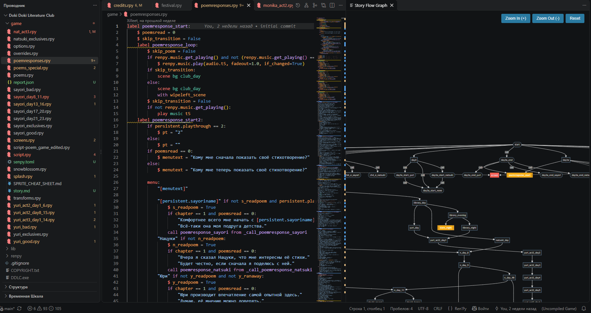
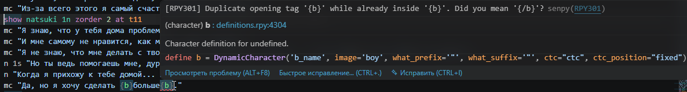
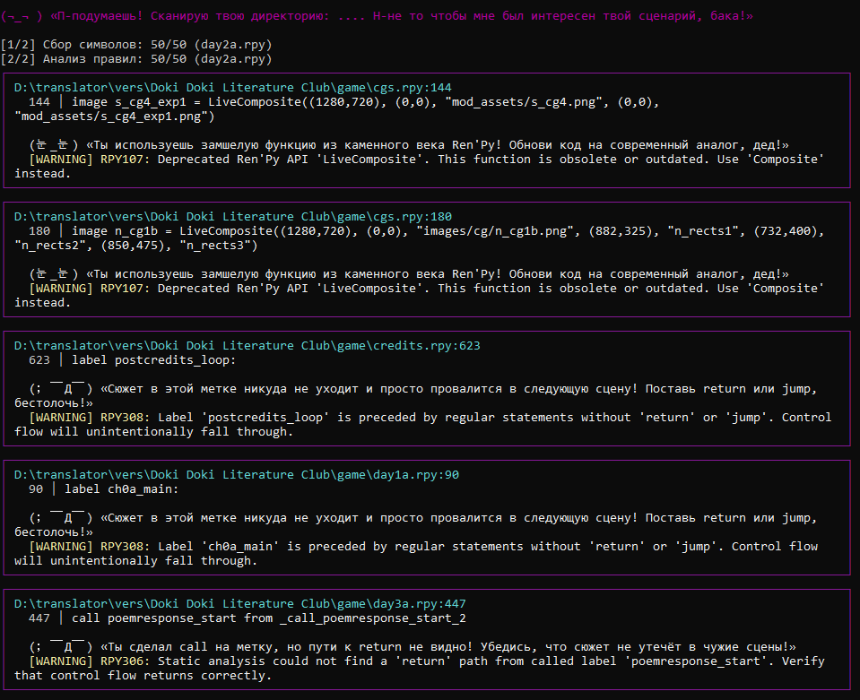
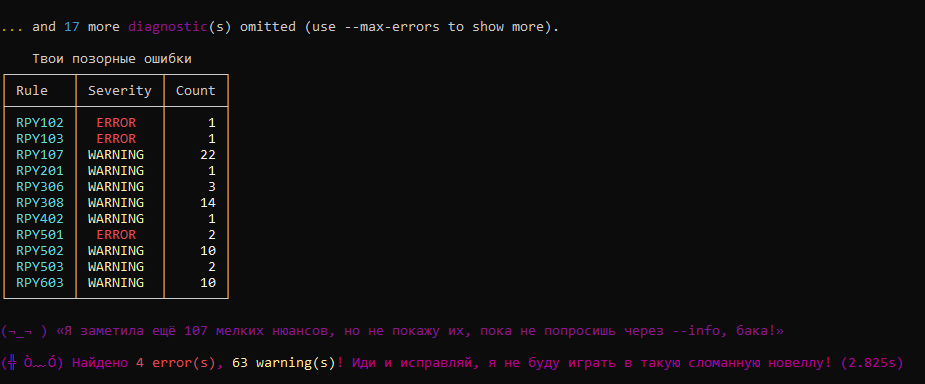

# Senpy — Ren'Py Linter & Language Server

[](https://www.python.org/downloads/)
[](https://www.renpy.org/)
[](https://github.com/Xilleet/senpy/blob/main/LICENSE)
[](https://github.com/Xilleet/senpy/actions)
[](https://pypi.org/project/senpy-linter/)

**Fast static analyzer, semantic linter and Language Server for Ren'Py visual novels.**

Detects undefined variables, broken labels, control-flow bugs, save/rollback issues, and translation errors — in real time, without launching the Ren'Py SDK.



---

## Why Senpy?

Ren'Py ships with a built-in `lint` command, but it launches the entire Pygame runtime and only catches syntax-level issues. Senpy is a **standalone static analyzer** that understands Ren'Py semantics:

- Variable mutations that break save files weeks after release.
- Menu choices with forgotten flags or contradictory conditions.
- Translation files where a variable or formatting tag was accidentally changed.
- Screen actions that mutate state on every frame.
- Story branches that lead nowhere.

---

## Key Features

- **51 semantic rules** (RPY1xx–RPY8xx) covering state, screens, dialogue, branching, assets, translation, dead code.
- **LSP with 20+ handlers**: diagnostics, completion, hover, go-to-definition, references, rename, folding, document symbols, workspace symbols, code actions, semantic tokens.
- **Interactive story graph** — visualize branching narrative as a Mermaid diagram.
- **Translation coverage reports** — find missing strings, mismatched variables, broken formatting tags in `game/tl/`.
- **CI/CD ready** — SARIF output for GitHub Code Scanning, one-command workflow scaffold (`senpy --init-ci`).
- **Plugin system** — write custom rules in Python.
- **Safe sandbox decompilation** — analyze `.rpyc` files via vendored `unrpyc` without touching your project.

---

## Screenshots

### Real-time diagnostics & autocomplete in VS Code


### CLI warnings


### Summary table


---

## Installation

### Option 1 — VS Code Extension (this page)

1. Click **Install** on this page (or search `Senpy` in the VS Code Extensions panel).
2. Open any `.rpy` file — diagnostics appear automatically.
3. If you want the full CLI / CI experience, also install the Python package: `pip install senpy-linter`.

### Option 2 — Python CLI / CI / Linux / macOS

```bash
pip install senpy-linter
senpy game/                       # analyze the whole project
senpy game/ --output-format sarif # for GitHub Code Scanning
senpy --init-ci                   # scaffold a GitHub Actions workflow
```

---

## Senpy vs built-in `renpy lint`

| Aspect | Ren'Py built-in lint | Senpy |
|---|---|---|
| Approach | Launches Pygame runtime | Static analysis, no SDK |
| Speed on 70k LOC | 30–40 seconds | ~10–15 ms per file |
| Save / rollback safety | ❌ | ✅ |
| Translation mismatch detection | ❌ | ✅ |
| Story graph visualization | ❌ | ✅ |
| CI-ready | Needs headless Ren'Py SDK | `pip install senpy-linter` + SARIF |
| IDE integration | ❌ | ✅ LSP for VS Code |

The two are **complementary**, not replacements — Senpy catches a different class of bugs that built-in lint cannot see.

---

## Senpy vs `vscode-language-renpy` (official extension)

`vscode-language-renpy` provides **syntax highlighting and basic snippets**. Senpy provides **semantic analysis**: it understands variables, control flow, screens, and translation files — not just text.

The two extensions are complementary and can be installed side-by-side. If you want both syntax highlighting (official) and semantic diagnostics (Senpy), install both.

---

## What Senpy detects

### State & save safety (RPY1xx)
- Variables used without `default`
- Mutations of `define` constants
- Non-revertable objects that break rollback
- Init phase dependency errors

### Screens & UI (RPY2xx)
- Predictive state mutations in screens
- Buttons without `action`
- Imperative loops in screen language
- Direct function calls instead of action lists
- Screen parameter leaks

### Dialogue & control flow (RPY3xx)
- Unclosed text tags (`{b}`, `{i}`, …)
- Jumps to non-existent labels
- Dead labels (unreachable code)
- Fallthroughs without explicit `jump`
- Missing `return` in called labels
- Bad sublabel jumps

### Menu & branching (RPY4xx)
- Forgotten flags in `menu` choices
- Empty choices
- Tautological / contradictory choice conditions
- Choices with args (anti-pattern)

### Assets & media (RPY5xx)
- Missing audio files referenced in `play`
- Case-mismatched image references
- Invalid transitions / transforms / ATL keywords
- Unregistered audio channels
- Duplicate image definitions

### Translation (RPY6xx)
- Variable mismatch between source and `game/tl/`
- Broken translation tags
- Empty `new` strings
- Tag mismatch between source and translation

### Dead code (RPY7xx)
- Unused `define` / `default` / `screen` / `transform` / `image` / `channel` / `param`

### Formatting (RPY8xx)
- Duplicate definitions
- Inconsistent style usage

Full rule reference: [RULES.md](https://github.com/Xilleet/senpy/blob/main/RULES.md).

---

## Who is Senpy for?

- **Ren'Py visual novel developers** — catch errors before players do.
- **Indie game studios** — integrate Senpy into CI to prevent regressions.
- **Ren'Py mod creators** (DDLC, etc.) — analyze decompiled `.rpyc` files safely.
- **Translation teams** — validate `game/tl/` files automatically.
- **Developers maintaining large branching narratives** — visualize the story graph.

---

## Configuration

| Setting | Default | Description |
|---|---|---|
| `senpy.executablePath` | `""` | Custom path to the `senpy` executable. Leave empty to use the bundled runtime. |

---

## Links

- [GitHub Repository](https://github.com/Xilleet/senpy)
- [Rules Reference](https://github.com/Xilleet/senpy/blob/main/RULES.md)
- [Architecture](https://github.com/Xilleet/senpy/blob/main/ARCHITECTURE.md)
- [Changelog](https://github.com/Xilleet/senpy/blob/main/CHANGELOG.md)
- [Report an Issue](https://github.com/Xilleet/senpy/issues)
- [Habr article (RU)](https://habr.com/ru/articles/1098624) — *«Senpy или зачем визуальной новелле семантический линтер»*
- [Lemma Soft Forums thread](https://lemmasoft.renai.us/forums/viewtopic.php?t=71294)
- [PyPI: senpy-linter](https://pypi.org/project/senpy-linter/)

---

## License

MIT — see [LICENSE](https://github.com/Xilleet/senpy/blob/main/senpy-vscode/LICENSE).

Vendored `unrpyc` is included under its own license — see [THIRD_PARTY_NOTICES.md](https://github.com/Xilleet/senpy/blob/main/senpy-vscode/THIRD_PARTY_NOTICES.md).
